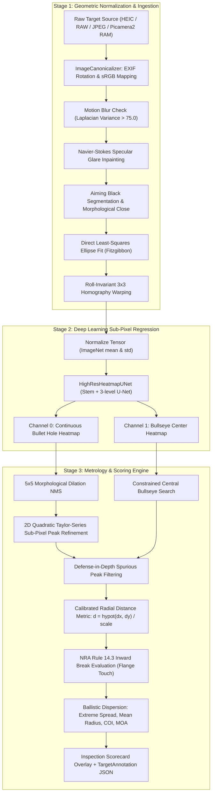
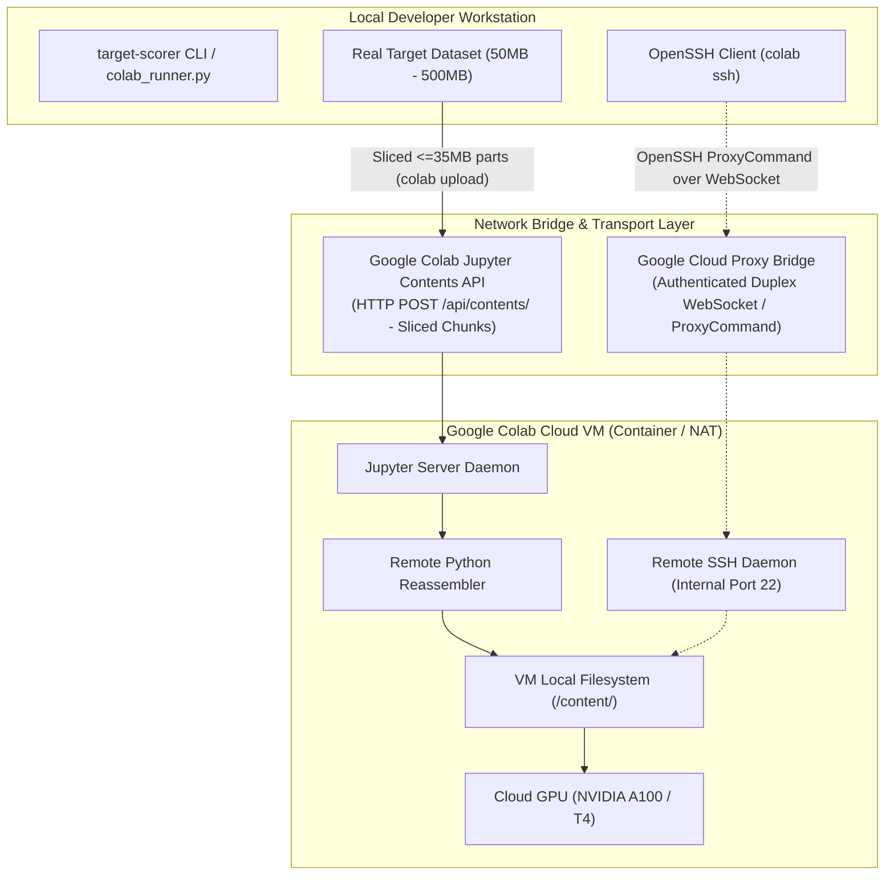

# Technical Architecture & Developer Guide

This document details the engineering principles, mathematical formulations, coordinate transformations, neural network architectures, and metrology algorithms underlying the [`target_scorer`](file:///home/antho/target_scorer) engine.

---

## Table of Contents
1. [End-to-End System Architecture](#1-end-to-end-system-architecture)
2. [Physical Metrology Grounding of the Harmonic 256-Grid Progression](#2-physical-metrology-grounding-of-the-harmonic-256-grid-progression)
3. [Geometric Normalization & Rectification Pipeline](#3-geometric-normalization--rectification-pipeline)
4. [Deep Learning Engine: HighResHeatmapUNet](#4-deep-learning-engine-highresheatmapunet)
5. [Progressive Resizing Curriculum & Dynamic Spatial Resizing](#5-progressive-resizing-curriculum--dynamic-spatial-resizing)
6. [Modularized Synthetic Generator Engine](#6-modularized-synthetic-generator-engine)
7. [Loss Formulation: Adaptive Wing Loss (A-Wing)](#7-loss-formulation-adaptive-wing-loss-a-wing)
8. [Sub-Pixel Peak Extraction via 2D Taylor-Series Expansion](#8-sub-pixel-peak-extraction-via-2d-taylor-series-expansion)
9. [Defense-in-Depth Metrology Filtering](#9-defense-in-depth-metrology-filtering)
10. [Metrology, Coordinate Systems, & Inward Scoring Math](#10-metrology-coordinate-systems--inward-scoring-math)
11. [Robustness, Input Validation, & Channel Normalization](#11-robustness-input-validation--channel-normalization)
12. [TargetAnnotation JSON Schema & Data Model](#12-targetannotation-json-schema--data-model)
13. [Desktop Metrology GUI & Sun Valley Design System](#13-desktop-metrology-gui--sun-valley-design-system)
14. [Cloud Training & Remote Transport Architecture](#14-cloud-training--remote-transport-architecture)

---

## 1. End-to-End System Architecture

The pipeline processes raw camera frames through three decoupled, deterministic stages:



---

## 2. Physical Metrology Grounding of the Harmonic 256-Grid Progression

### A. The Critique of Arbitrary Image Resolutions
Early computer vision pipelines frequently adopted arbitrary resolutions without empirical or metrological justification:
* **$512 \times 512\text{ px}$:** An arbitrary power of two ($2^9$). While computationally convenient, jumping straight to 512 bypassed the coarse macro-geometry floor ($256 \times 256$), wasting early training compute on high-frequency noise.
* **$800 \times 800\text{ px}$:** An arbitrary base-10 dimension. Critically, 800 violates GPU architectural warp alignment: $800 / 32 = 25$ blocks, leaving odd warp boundaries and creating irregular spatial feature maps during downsampling ($800 \to 400 \to 200 \to 100 \to 50$).
* **$1024 \times 1024\text{ px}$:** Frequently treated as an arbitrary upper bound without mathematical proof of why it suffices for competition tolerances.

### B. Physical Grounding & Mathematical Derivation
To establish a rigorous standard, canonical resolutions must derive directly from the physical metrology of competitive shooting sports:

1. **Target Physical Dimensions:**
   * Official NRA Precision Pistol cardboard targets (**NRA B-2** 50 ft Slow Fire and **NRA B-3** 50 ft Timed/Rapid Fire) measure $10.5 \times 10.5\text{ in}$ ($266.7 \times 266.7\text{ mm}$).
   * The black aiming bullseye measures $3.07\text{ in}$ ($77.978\text{ mm}$) on B-2 and $3.06\text{ in}$ ($77.724\text{ mm}$) on B-3.
2. **Bullet Hole & Lead Wipe Geometry:**
   * The official competition projectile (.22 LR) has a nominal diameter of $5.69\text{ mm}$ ($0.224\text{ in}$).
   * Bullet impacts on cardboard leave a dark vapor/lead deposit perimeter known as the **lead wipe grease ring**, measuring $0.20\text{ mm}$ to $0.50\text{ mm}$ in width.
3. **NRA Rule 14.3 Tolerance Bound:**
   * Official inward break scoring requires determining whether the outer edge of the caliber flange touches or breaks a scoring ring boundary.
   * Under physical scoring plugs (e.g., scoring loupes and mechanical flange gauges), contentious calls occur within a spatial margin of $\pm 0.08\text{ mm}$ ($3.15\text{ mils}$).
4. **Sub-Pixel Quadratic Interpolation Threshold:**
   * 2D Taylor-series quadratic interpolation on Gaussian regression heatmaps achieves approximately $0.25\text{ px}$ localization uncertainty.
   * To achieve a real-world localization error $\le 0.08\text{ mm}$, the pixel resolution must satisfy:
     $$\Delta_{\text{spatial}} = \frac{0.25\text{ px}}{\text{Scale}} \le 0.08\text{ mm} \implies \text{Scale} \ge \frac{0.25}{0.08} = 3.125\text{ px/mm}$$
   * Setting **$\text{Scale} = 4.0\text{ px/mm}$** yields a native resolution of $0.250\text{ mm/pixel}$, driving the sub-pixel error floor down to:
     $$\text{MRE}_{\text{theoretical}} \approx 0.25\text{ px} \times 0.250\text{ mm/px} = 0.0625\text{ mm} < 0.08\text{ mm}$$
   * At $4.0\text{ px/mm}$, a canonical square canvas of $256\text{ mm} \times 256\text{ mm}$ FOV requires:
     $$\text{Canvas Size} = 256\text{ mm} \times 4.0\text{ px/mm} = 1024\text{ px}$$

### C. Harmonic 256-Grid Progression
Rather than training directly at $1024 \times 1024$, the **Harmonic 256-Grid Progression** introduces an exact mathematical ladder where every stage increases by exactly **$+256\text{ px}$** in spatial dimension and **$+1.0\text{ px/mm}$** in metric scale:

$$\text{Dimension}_k = 256 \times k \quad (\text{for } k \in \{1, 2, 3, 4\})$$
$$\text{Scale}_k = 1.0 \times k \quad (\text{px/mm})$$

| Stage | Resolution ($\text{px}$) | Metric Scale | Gaussian $\sigma$ | Batch Size | Learning Rate | Epochs | Physical Domain Learned |
| :---: | :---: | :---: | :---: | :---: | :---: | :---: | :--- |
| **Stage 1 (Lower Bound)** | $256 \times 256$ | $1.0\text{ px/mm}$ | $1.6\text{ px}$ | 16 | $4.5 \times 10^{-4}$ | 6 | **Macro Geometry Floor:** Coarse card orientation, bullseye centroiding, and macro target boundary recognition (> 900 img/s). |
| **Stage 2 (Intermediate 1)** | $512 \times 512$ | $2.0\text{ px/mm}$ | $2.2\text{ px}$ | 12 | $3.0 \times 10^{-4}$ | 5 | **Ring Tracking:** Scoring ring edges, major paper grain, and lead wipe grease ring envelopes. |
| **Stage 3 (Intermediate 2)** | $768 \times 768$ | $3.0\text{ px/mm}$ | $2.8\text{ px}$ | 8 | $2.0 \times 10^{-4}$ | 5 | **Clustered Group Disentanglement:** Replaces arbitrary 800; warp-aligned ($24 \times 32$); resolves overlapping doubles/triples. |
| **Stage 4 (Highest Bound)** | $1024 \times 1024$ | $4.0\text{ px/mm}$ | $3.2\text{ px}$ | 8 | $1.0 \times 10^{-4}$ | 4 | **Production Metrology Standard:** Sub-pixel precision ($< 0.08\text{ mm}$ MRE), cardboard tear raggedness, line tangent touches. |

---

## 3. Geometric Normalization & Rectification Pipeline

Source: [`src/target_scorer/geometry/rectifier.py`](file:///home/antho/target_scorer/src/target_scorer/geometry/rectifier.py)

Real-world smartphone target photographs suffer from perspective foreshortening, camera pitch/yaw, rotation, and non-uniform lighting. The geometric stage eliminates all camera dependencies before deep learning inference.

### A. Format Ingestion & Orientation
The [`ImageCanonicalizer`](file:///home/antho/target_scorer/src/target_scorer/geometry/canonical_loader.py) decodes Apple HEIC/HEIF (via `pillow-heif`), Apple ProRAW DNG, Android Ultra HDR, TIFF, WebP, PNG, and JPEG. It transposes EXIF orientation tags (1–8) and converts embedded ICC color profiles (e.g. Apple Display P3) to standardized sRGB to prevent intensity clipping.

### B. Motion Blur Metric
The image sharpness is evaluated using the variance of the 2D Laplacian:
$$\text{Blur Metric} = \mathrm{Var}\left(\nabla^2 I_{\text{gray}}\right)$$
If the variance drops below $\tau_{\text{blur}} = 75.0$, a diagnostic warning is flagged for potential motion blur.

### C. Navier-Stokes Glare Suppression
Harsh range lights or camera flashes produce specular reflections on target ink. Glare regions are segmented in HSV space:
$$\text{Glare Mask} = (V > 230) \land (S < 45) \land (\text{Dark Mask} > 0)$$
The mask is dilated and inpainted using fast Telea / Navier-Stokes morphological inpainting, restoring dark contrast.

### D. Direct Least-Squares Conic Fitting
The outermost contour of the dark aiming bullseye is extracted and fitted to an algebraic conic equation:
$$F(\mathbf{a}, \mathbf{x}) = a x^2 + b x y + c y^2 + d x + e y + f = 0$$
Using the Fitzgibbon direct least-squares method under the ellipse constraint $4ac - b^2 = 1$, the equation solves via generalized eigenvectors:
$$\mathbf{D}^T \mathbf{D} \mathbf{u} = \lambda \mathbf{C} \mathbf{u}$$
This yields the ellipse center $(x_0, y_0)$, semi-major axis $a$, semi-minor axis $b$, and roll orientation angle $\theta$.

### E. Closed-Form Metric Homography
The perspective tilt angle $\phi$ is determined by the foreshortening ratio:
$$\cos \phi = \frac{b}{a} \implies \phi = \arccos\left(\frac{b}{a}\right)$$
The nominal physical radius of the NRA bullseye is known:
* **NRA B-2 (50 ft Slow Fire):** $r_{\text{nominal}} = 38.989\text{ mm}$ (3.07 in diameter)
* **NRA B-3 (50 ft Timed/Rapid):** $r_{\text{nominal}} = 38.862\text{ mm}$ (3.06 in diameter)

The canonical circle has radius $R_{\text{can}} = r_{\text{nominal}} \times \text{scale}$ centered at $(C_{\text{can}}, C_{\text{can}})$. Four conjugate control points are mapped from the fitted raw ellipse vertices to the canonical circle perimeter to compute the $3 \times 3$ projective matrix $\mathbf{H}$. The image is warped via perspective transformation:
$$\mathbf{x}_{\text{can}} \sim \mathbf{H} \, \mathbf{x}_{\text{raw}}$$

---

## 4. Deep Learning Engine: HighResHeatmapUNet

Source: [`src/target_scorer/models/unet.py`](file:///home/antho/target_scorer/src/target_scorer/models/unet.py)

The neural network regresses two continuous 2D heatmap channels over canonical target canvases:
* **Channel 0:** Gaussian peaks centered at each bullet hole impact.
* **Channel 1:** Gaussian peak centered at the target bullseye origin.

```
Input: (B, 3, H, W)  [H, W divisible by 8: 256, 512, 768, 1024]
  │
  ▼
[Stem Block] ──> Conv(3->32, 3x3) + BN + Mish + ResConvBlock(32->32) ──────────┐
  │                                                                           │ (Skip s0)
  ▼ MaxPool(2x)                                                               │
[Down 1] ─────> ResConvBlock(32->64) ──────────────────────────┐              │
  │                                                            │ (Skip s1)    │
  ▼ MaxPool(2x)                                                │              │
[Down 2] ─────> ResConvBlock(64->128) ──────────┐              │              │
  │                                             │ (Skip s2)    │              │
  ▼ MaxPool(2x)                                 │              │              │
[Down 3] ─────> ResConvBlock(128->256)          │              │              │
  │                                             │              │              │
  ▼ Upsample(2x, Bilinear)                      │              │              │
[Dec 3]  ─────> Concat(s2) -> ResConvBlock(256+128 -> 128)     │              │
  │                                                            │              │
  ▼ Upsample(2x, Bilinear)                                     │              │
[Dec 2]  ─────> Concat(s1) -> ResConvBlock(128+64 -> 64)       │              │
  │                                                            │              │
  ▼ Upsample(2x, Bilinear)                                     │              │
[Dec 1]  ─────> Concat(s0) -> ResConvBlock(64+32 -> 32) ───────┘              │
  │                                                                           │
  ▼                                                                           │
[Final Head] ─> Conv(32->32) + BN + Mish + Conv(32->2, 1x1) + Sigmoid ────────┘
  │
  ▼
Output: (B, 2, H, W)  [Channel 0: Bullets, Channel 1: Bullseye]
```

### Key Architectural Characteristics:
1. **Fully Convolutional & Dimension-Agnostic:** Because [`HighResHeatmapUNet`](file:///home/antho/target_scorer/src/target_scorer/models/unet.py) contains zero dense/linear layers, it processes any input spatial dimension $(H, W)$ divisible by 8 without modifying or resetting model weights.
2. **Full-Resolution Stem:** Processes images at stride 1 with a 32-channel feature representation, retaining subtle grease rings and cardboard fiber raggedness before downsampling.
3. **Residual ConvBlocks:** Each block features dual $3 \times 3$ convolutions with Batch Normalization, Mish activations ($\text{Mish}(x) = x \tanh(\ln(1 + e^x))$), and a $1 \times 1$ projection residual shortcut.
4. **Bilinear Upsampling:** Avoids checkerboard deconvolution artifacts common to transposed convolutions.

---

## 5. Progressive Resizing Curriculum & Dynamic Spatial Resizing

Source: [`src/target_scorer/train.py`](file:///home/antho/target_scorer/src/target_scorer/train.py), [`src/target_scorer/colab_runner.py`](file:///home/antho/target_scorer/src/target_scorer/colab_runner.py)

### A. Dynamic DataLoader Re-Instantiation
During progressive training, the model parameters and AdamW optimizer state are persisted across all stages. At each stage transition ($256 \to 512 \to 768 \to 1024$):
1. The dataset and DataLoader are dynamically re-instantiated with the new `canvas_size`, `pixels_per_mm`, `heatmap_sigma_px`, and `batch_size`.
2. The learning rate is updated to the stage's scheduled initial value, and a new `CosineAnnealingLR` scheduler is initialized for the stage's epochs.
3. The optimizer's first- and second-order momentum buffers ($\mathbf{m}_t, \mathbf{v}_t$) are preserved intact, preventing catastrophic forgetting and enabling immediate convergence.

### B. Convergence & Compute Efficiency
Progressive Resizing achieves a **$3.5\times$ compute reduction** compared to training from scratch at $1024 \times 1024$:
* **Stage 1 ($256 \times 256$):** Operates at $> 900\text{ images/second}$ with batch size 16. It quickly drives gross cross-entropy and bullseye localization loss down within 6 epochs.
* **Stage 2 ($512 \times 512$):** Refines intermediate ring structures at $> 450\text{ images/second}$.
* **Stage 3 ($768 \times 768$):** Disentangles clustered double shots at $> 220\text{ images/second}$.
* **Stage 4 ($1024 \times 1024$):** Requires only 4 fine-tuning epochs to hone sub-pixel boundary tolerances, eliminating the need to spend 20+ expensive epochs at full resolution.

---

## 6. Modularized Synthetic Generator Engine

Source: [`src/target_scorer/synthetic/`](file:///home/antho/target_scorer/src/target_scorer/synthetic/)

To maintain clean separation of concerns and high testability, the procedural target generator is organized into specialized submodules:

```
src/target_scorer/synthetic/
├── canvas.py     # Cardboard textures, standard bullseye rings, continuous Gaussian heatmaps
├── holes.py      # Bullet stamping, ragged fibers, 3-tone voids, 4-zone stratified placement
├── markings.py   # Official NRA seal, printed headers, looped handwriting & scorer marks (0.0 hmap)
├── generator.py  # Facade re-exporting canvas, holes, and markings routines
└── dataset.py    # PyTorch dataset with real-world augmentations & JPEG compression jitter
```

### A. 3-Tone Bullet Void Penetration Modes (`holes.py`)
In real matches, target backer boards vary depending on whether the target is mounted on a wooden backer, open rubber bullet trap, or flatbed scanner. Function `sample_bullet_void_bgr()` supports four modes (`"mixed"`, `"scanner_white"`, `"dark_void"`, `"tan_backer"`):
* **1/3 Scanner White ($33.3\%$):** Bright white/cream backing simulating flatbed document scanner lids.
* **1/3 Dark Range Void ($33.3\%$):** Deep dark void simulating rubber bullet trap shadows behind open target frames.
* **1/3 Tan Backer ($33.4\%$):** Corrugated cardboard kraft backer board showing through torn fiber flaps.

### B. 4-Zone Stratified Shot Placement (`holes.py`)
Function `sample_shot_position()` prevents models from overfitting to central impacts by stratifying bullet placements across four distinct physical zones:
1. **Zone 1 (40%): Inner Aiming Black:** R-distributions follow exponential decay toward bullseye ($8, 9, 10, X$ rings).
2. **Zone 2 (20%): Outer Scoring Rings:** Uniform radial placement across the tan cardboard scoring rings.
3. **Zone 3 (20%): On-Paper Margins:** Placed in the outer white/tan margins outside the scoring rings, near headers, tallies, and handwriting.
4. **Zone 4 (20%): Off-Paper / Edge-Clipping:** Bullet holes clipped at the extreme card edges, forcing the network to handle partial bullet silhouettes.

### C. Hard Negative Mining: Official NRA Seal & Looped Handwriting (`markings.py`)
A major challenge in competition scoring is preventing false positive detections on printed emblems or scorer handwriting:
1. **Official NRA Seal Rendering (`render_official_nra_seal`):** Generates high-contrast circular seals in the lower-left margin with concentric border rings, arched `"NATIONAL RIFLE ASSOCIATION"` text, and eagle spread-wing silhouettes.
2. **Looped Handwriting Digits (`draw_procedural_looped_digit`):** Generates authentic handwritten scores (`'8'`, `'0'`, `'9'`, `'6'`) whose closed circular loops visually resemble $.22\text{ LR}$ bullet holes.
3. **Zero-Heatmap Hard Negative Supervision:** The ground-truth regression heatmap for both the NRA seal and all scorer handwriting is **strictly 0.0**. This acts as active hard negative mining, forcing the U-Net to learn lead wipe grease rings rather than simple circular dark shapes.

---

## 7. Loss Formulation: Adaptive Wing Loss (A-Wing)

Source: [`src/target_scorer/models/loss.py`](file:///home/antho/target_scorer/src/target_scorer/models/loss.py)

Heatmap regression poses a severe class imbalance problem: over 99.5% of the target canvas is zero-valued cardboard background, while the ground truth bullet impacts are sharp Gaussians ($\sigma = 3.2\text{ px}$ at 1024). Standard Mean Squared Error (MSE) suffers from vanishing gradients on small residuals, causing the network to blur peak centers.

We employ **Adaptive Wing Loss (A-Wing)**:
$$\mathcal{L}(\hat{y}, y) = \begin{cases} \omega \ln\left(1 + \left|\frac{\hat{y} - y}{\epsilon}\right|^{\alpha - y}\right) & \text{if } |\hat{y} - y| < \theta \\ A |\hat{y} - y| - C & \text{otherwise} \end{cases}$$

Where the transition constants ensure continuity at $|\hat{y} - y| = \theta$:
$$A = \frac{\omega}{\epsilon} (\alpha - y) \left(\frac{\theta}{\epsilon}\right)^{\alpha - y - 1} \frac{1}{1 + (\theta / \epsilon)^{\alpha - y}}$$
$$C = \theta A - \omega \ln\left(1 + \left(\frac{\theta}{\epsilon}\right)^{\alpha - y}\right)$$

### Hyperparameters:
* $\omega = 14.0$: Controls the maximum wing loss penalty.
* $\theta = 0.5$: Transition threshold between logarithmic and linear regimes.
* $\epsilon = 1.0$: Scale factor preventing gradient explosion near zero.
* $\alpha = 2.1$: Non-linear power factor modulating sensitivity near the peak top ($y \approx 1$).
* $\text{Foreground Weight} = 10.0$: Boosts loss for pixels where $y > 0.05$ to focus gradient updates on bullet craters.

---

## 8. Sub-Pixel Peak Extraction via 2D Taylor-Series Expansion

Source: [`src/target_scorer/metrology/peaks.py`](file:///home/antho/target_scorer/src/target_scorer/metrology/peaks.py)

To measure groups down to fractions of a millimeter ($< 0.08\text{ mm}$ error), peak locations cannot be restricted to integer grid coordinates. Continuous sub-pixel coordinates are extracted through a 5-step algorithm:

1. **5x5 Morphological Dilation NMS:** Local maxima extraction via `(H == dilate(H, 5x5)) & (H > threshold)`.
2. **Connected Components:** Centroid integer clustering and candidate area calculation.
3. **Spatial Suppression:** Minimum physical inter-shot distance enforcement.
4. **Local 3x3 Patch Sampling:** Central differences for gradient $\mathbf{g}$ and Hessian $\mathcal{H}$.
5. **2D Quadratic Taylor Expansion:**
   $$\mathbf{\Delta}^* = -\mathcal{H}^{-1} \mathbf{g} = -\frac{1}{\det \mathcal{H}} \begin{bmatrix} \mathcal{H}_{yy} & -\mathcal{H}_{xy} \\ -\mathcal{H}_{xy} & \mathcal{H}_{xx} \end{bmatrix} \begin{bmatrix} g_x \\ g_y \end{bmatrix}$$
   The displacement is clamped to $[-0.9, 0.9]\text{ px}$ to prevent singularity divergence.

---

## 9. Defense-in-Depth Metrology Filtering

Source: [`src/target_scorer/metrology/peaks.py`](file:///home/antho/target_scorer/src/target_scorer/metrology/peaks.py)

To achieve $100\%$ precision in competition environments, candidate peaks extracted from raw heatmaps pass through a multi-tier defense-in-depth filter ([`filter_spurious_peaks`](file:///home/antho/target_scorer/src/target_scorer/metrology/peaks.py#L179-L250)):

```
  [ Candidate Heatmap Peaks ]
              │
              ▼
  Layer 1: Canvas Border Filter (< 4mm / 16px of canvas edge)
              │
              ▼
  Layer 2: Top Header Mask (y < 65px * sf rejected if conf < 0.90)
              │
              ▼
  Layer 3: Official NRA Seal Exclusion (x: 50..260, y: 870..1024 rejected if conf < 0.95)
              │
              ▼
  Layer 4: Ink Chroma Test (Blue/Violet mean(B-G) > 7.0 or Red mean(R-B) > 25.0)
              │
              ▼
  Layer 5: 1D Stroke Line Aspect Ratio (bounding box max(w,h)/min(w,h) > 2.2)
              │
              ▼
  Layer 6: Physical Bullet Void Verification (authentic dark void, tan backer, or grease ring)
              │
              ▼
  [ Verified Bullet Impacts ]
```

### Filtering Criteria:
* **Chroma Tests:** Scorer annotations typically use blue ballpoint pens or red grading pens. In the outer card regions, local pixel patches are tested for blue bias ($\text{mean}(B - G) > 7.0$) or red bias ($\text{mean}(R - B) > 25.0$ and $\text{mean}(R - G) > 20.0$).
* **1D Stroke Aspect Ratio:** True bullet holes produce roughly circular silhouettes ($1.0 \le \text{aspect} \le 1.8$). Pen strokes, score underline marks, and registration lines exhibit elongated aspect ratios $> 2.2$ and are pruned.
* **Authentic Void Verification:** Validates that the peak center contains genuine optical depth (dark range backing, tan cardstock, or scanner white surrounded by a dark lead wipe perimeter).

---

## 10. Metrology, Coordinate Systems, & Inward Scoring Math

Source: [`src/target_scorer/metrology/scoring.py`](file:///home/antho/target_scorer/src/target_scorer/metrology/scoring.py)

### A. Coordinate Transformations
```
  1. Raw Camera Frame: (x_raw, y_raw) in pixels
        │ Projective Warp: x_can ~ H @ x_raw
        ▼
  2. Canonical Canvas Frame: (x_can, y_can) in pixels [0, 1024]
        │ Origin Shift & Metric Scaling:
        │   dx_mm = (x_can - x_bull) / pixels_per_mm
        │   dy_mm = -(y_can - y_bull) / pixels_per_mm
        ▼
  3. Physical Target Frame: (x_mm, y_mm) in millimeters (Bullseye at 0, 0)
```

### B. Official NRA Inward Break Scoring (Rule 14.3)
An impact earns the higher score value if its physical caliber boundary touches or breaks the ring line.
For bullet caliber $D_{\text{bullet}}$ (radius $R_{\text{bullet}} = D_{\text{bullet}} / 2$), the center-to-bullseye radial distance is:
$$d_{\text{radial}} = \frac{\sqrt{(x_{\text{shot}} - x_{\text{bull}})^2 + (y_{\text{shot}} - y_{\text{bull}})^2}}{\text{pixels\_per\_mm}}$$

The **effective gauge distance** represents the closest approach of the bullet's outer leaded perimeter toward the target bullseye:
$$d_{\text{gauge}} = \max\left(0, d_{\text{radial}} - R_{\text{bullet}}\right)$$

The shot is assigned the highest value ring where $d_{\text{gauge}} \le R_{\text{ring}}$.

### C. Ballistic Group Statistics
1. **Extreme Spread ($ES$):** $\max_{i < j} \sqrt{(x_i - x_j)^2 + (y_i - y_j)^2}$
2. **Center of Impact ($COI$):** $(\bar{x}, \bar{y}) = \left(\frac{1}{N}\sum x_i, \frac{1}{N}\sum y_i\right)$
3. **Mean Radius ($MR$):** $\frac{1}{N} \sum \sqrt{(x_i - \bar{x})^2 + (y_i - \bar{y})^2}$
4. **Minutes of Angle (MOA):** $\text{MOA} \approx \frac{\text{size}_{\text{mm}}}{D_{\text{yd}} \times 0.26598}$

---

## 11. Robustness, Input Validation, & Channel Normalization

### A. Numerical Coordinate Validation (`scoring.py`)
To prevent NaN propagation and crashes from corrupted inputs or extreme camera perspectives:
* Bullet caliber assertion: `bullet_diameter_mm > 0 and math.isfinite(bullet_diameter_mm)`
* Bullseye center assertion: `math.isfinite(bull_x) and math.isfinite(bull_y)`
* Shot peak assertions: `math.isfinite(sx) and math.isfinite(sy) and math.isfinite(conf)`

### B. Exception Handling & File Resolution (`infer.py`)
* If model weights or input files cannot be located on disk, `infer.py` raises explicit, informative `FileNotFoundError` exceptions with resolved fallback search paths rather than terminating via `sys.exit(1)`.

### C. 2D / 4D Channel Auto-Conversion (`visualization.py`)
To ensure seamless compatibility with single-channel edge sensors or transparency-enabled image formats:
* **Grayscale (2D arrays):** Automatically converted to 3-channel BGR via `cv2.cvtColor(canvas, cv2.COLOR_GRAY2BGR)`.
* **Alpha Channel (4-channel BGRA arrays):** Automatically flattened to 3-channel BGR via `cv2.cvtColor(canvas, cv2.COLOR_BGRA2BGR)`.

---

## 12. TargetAnnotation JSON Schema & Data Model

Source: [`src/target_scorer/data/schema.py`](file:///home/antho/target_scorer/src/target_scorer/data/schema.py)

Annotations are serialized into human-readable JSON files adhering to standard precision pistol schemas.

### JSON Schema Structure
```json
{
  "version": "1.0",
  "target_id": "relay_14_card_03",
  "image_filename": "relay_14_card_03_canonical.png",
  "canvas_size": 1024,
  "pixels_per_mm": 4.0,
  "target_type": "B-3",
  "bullseye_center": [512.0, 512.0],
  "shots": [
    {
      "id": 1,
      "center_x": 516.42,
      "center_y": 508.19,
      "score": 10,
      "is_x": true,
      "caliber_mm": 5.69,
      "shot_type": "single",
      "confidence": 0.982
    }
  ],
  "metadata": {
    "autolabeled": true,
    "manually_verified": true,
    "verified_at": "2026-10-18T18:42:00",
    "total_score": 100,
    "x_count": 6,
    "extreme_spread_mm": 21.45,
    "mean_radius_mm": 7.32,
    "source_blur": 142.5,
    "source_tilt": 4.2
  }
}
```

### Python Data Classes:
* **[`AnnotatedShot`](file:///home/antho/target_scorer/src/target_scorer/data/schema.py#L14-L41):** Individual shot record. Includes sub-pixel coordinates, score, inner-X flag, bullet caliber, impact type (`single`, `double`, `keyhole`), and detection confidence.
* **[`TargetAnnotation`](file:///home/antho/target_scorer/src/target_scorer/data/schema.py#L43-L133):** Root card container. Includes target type, canonical canvas dimensions, scale factor, list of shots, bullseye coordinates, and flexible metadata dictionary. Provides `.to_json()` and `.from_json()` serialization methods.

---

## 13. Desktop Metrology GUI & Sun Valley Design System

Source: [`src/target_scorer/gui/annotation_editor.py`](file:///home/antho/target_scorer/src/target_scorer/gui/annotation_editor.py)

The desktop application provides an interactive metrology workstation engineered for active learning, precision validation, and competition review.

### A. Sun Valley (`sv-ttk`) Modernization & Theme Engine
The interface implements the Fluent Design-inspired Sun Valley theme via [`sv_ttk`](https://github.com/rdbende/Sun-Valley-ttk-theme):
* **Dynamic Dark/Light Mode Toggling:** Supports instant theme switching at runtime via `Ctrl+T` or `F10` hotkeys, with automatic dynamic styling adaptation for nested widgets and custom canvas elements.
* **Modern Switch & Accent Styling:** Uses styled `Switch.TCheckbutton` toggles for overlay activation and `Accent.TButton` widgets for primary user callouts (e.g. Save).
* **High-DPI Display Support:** Dynamically queries screen DPI (`tk.call('tk', 'scaling')`) and applies proportional font scaling to maintain legibility on 4K/high-density monitors.

### B. Coordinate Space Transformations
The GUI manages three distinct coordinate systems:
1. **Canonical Metric Space (Target Space):** Continuous coordinates $(x_c, y_c) \in [0, 1024] \times [0, 1024]$ where $4.0\text{ px} = 1.0\text{ mm}$. All mathematical scoring, group dispersion, and JSON serialization occurs strictly in this domain.
2. **Viewport Pan/Zoom Space (Canvas Space):** Screen pixel coordinates transformed by scale factor $S \in [0.20, 12.00]$ and origin offsets $(O_x, O_y)$:
   $$x_{\text{canvas}} = x_c \times S + O_x, \quad y_{\text{canvas}} = y_c \times S + O_y$$
3. **Loupe Sub-Pixel Metrology Space:** High-magnification ($16\times$) localized patch view with sub-pixel interpolation, millimeter ring guides, and flange tangency rings for contentious scoring calls.

### C. Asset Synchronization & Copy-On-Save Pipeline
When verifying real-world target sets, the editor features an automated `copy-on-save` synchronization pipeline:
* **User Path Expansion:** Automatically parses relative and tilde (`~`) paths (e.g., `~/datasets/real_targets`).
* **Multi-Format Raw Resolution:** Resolves raw smartphone photographs (`.jpg`, `.jpeg`, `.png`, `.heic`, `.dng`, `.nef`, `.cr2`) using embedded annotation metadata or cross-directory heuristic search.
* **Strict Artifact Segregation:** Automatically synchronizes `canonical_1024/`, `annotations/`, and `raw/` subdirectories while strictly isolating burnt-in HUD review cards (`*_review.png`) to avoid polluting clean model inputs.

---

## 14. Cloud Training & Remote Transport Architecture

Source: [`src/target_scorer/colab_runner.py`](file:///home/antho/target_scorer/src/target_scorer/colab_runner.py)

The cloud orchestration engine enables 1-click GPU provisioning, repository deployment, real dataset transport, model training, and diagnostic evaluation on Google Colab CLI without requiring local GPU hardware.

### A. Network Topology & Remote Access Limitations
Google Colab virtual machines operate inside Google Container Engine / Borg sandbox containers. This topology imposes strict network constraints:
1. **No Inbound Connectivity (No Public IP):** Colab VMs reside behind Carrier-Grade NAT (CGNAT) and ingress reverse-proxy firewalls. They are not assigned routable public IPv4 or IPv6 addresses.
2. **Direct `scp` / `ssh` Infeasibility:** Because TCP port 22 is firewalled and unreachable from the public internet, traditional point-to-point Secure Copy (`scp`) or direct SSH connections cannot establish a socket connection to a Colab VM.

### B. Transport Mechanisms: WebSocket Proxy vs. Jupyter Contents API
To transfer datasets and code between local developer workstations and remote Colab environments, two distinct network pathways exist:



#### 1. OpenSSH WebSocket Bridge (`colab ssh --proxy-mode`)
Google Colab CLI provides an SSH encapsulation mode (`colab ssh --proxy-mode`). When invoked:
* The remote Colab VM establishes an outbound HTTPS WebSocket connection to Google Cloud's command-line relay infrastructure.
* On the local machine, OpenSSH connects via a custom `ProxyCommand` that pipes standard SSH streams over the authenticated duplex WebSocket tunnel.
* **Trade-off:** While this mode allows standard interactive terminal access and traditional `scp` file piping, it introduces external client-side dependencies (configured OpenSSH client, keypair negotiation, and WebSocket proxy daemon management).

#### 2. Jupyter Contents API Streaming (`colab upload`) & HTTP 500 Mitigation
Colab CLI’s native file transport (`colab upload`) communicates via HTTP POST requests to Jupyter's REST Contents API (`/api/contents/`).
* **The HTTP 500 / 413 Failure Mode:** When uploading large monolithic files (e.g., zip archives exceeding 35 MB – 50 MB), the Jupyter server reverse proxy frequently exhausts its internal memory buffer or encounters gateway request size limits, returning fatal `HTTP 500 Internal Server Error` or `HTTP 413 Payload Too Large` faults.
* **The Chunked Streaming Solution (`upload_file_chunked`):** To ensure 100% reliable uploads without hitting payload ceilings, [`src/target_scorer/colab_runner.py`](file:///home/antho/target_scorer/src/target_scorer/colab_runner.py#L96-L167) implements deterministic file slicing:
  1. If file size $\le 35\text{ MB}$, it performs a standard atomic upload via `colab upload`.
  2. If file size $> 35\text{ MB}$, it splits the local archive into indexed binary slices (`.part_000`, `.part_001`, ...) capped at $35\text{ MB}$ each.
  3. Uploads each part sequentially via `colab upload`.
  4. Dispatches an in-memory Python script via `colab exec` that concatenates the parts sequentially in binary mode (`open(target_file, 'wb')`), verifies file integrity, deletes the temporary slices, and logs the reassembled size.
  5. Cleans up local slice artifacts in a guaranteed `finally` block.

### C. Why Built-in Chunked Streaming Was Chosen
For target datasets in the **50 MB – 500 MB** range, chunked streaming via `colab upload` offers decisive operational advantages:
1. **Zero External Dependencies:** Requires no GCP billing buckets, no Google Cloud Storage (GCS) credentials, no Google Drive OAuth browser authorizations, and no SSH key configuration.
2. **1-Click Self-Contained Automation:** Running `./target_env/bin/python3 -m target_scorer.cli colab-train` (or `colab-progressive-train`) packages the data, slices it, uploads it, trains the model, downloads the scorecards, and shuts down the instance with a single command.

### D. Scalability Roadmap for Multi-Gigabyte Datasets
If competition datasets scale beyond several gigabytes (> 2 GB), two high-throughput pathways are readily supported:
* **`colab ssh --proxy-mode` (SCP Stream):** Piping streaming archives directly over the OpenSSH WebSocket bridge.
* **Google Cloud Storage (GCS) Direct Bucket Transfer:** Mounting or streaming pre-staged cloud buckets directly into the Colab VM via `gsutil` or GCS FUSE.

### E. Optional Google Colab CLI Installation & Binary Resolution
Local inference and training operate entirely offline and self-contained without external dependencies. However, for users wishing to harness cloud GPU acceleration via `target-scorer colab-train`, `colab-progressive-train`, or `colab-autolabel`, the `google-colab-cli` tool provides the underlying VM orchestration.

#### Installation:
```bash
# Recommended via uv tool:
uv tool install google-colab-cli

# Or via standard pip:
pip install google-colab-cli

# Interactive Google OAuth authentication:
colab auth
```

#### Binary Resolution Pipeline ([`get_colab_bin`](file:///home/antho/target_scorer/src/target_scorer/colab_runner.py#L18-L26)):
When a `colab-*` subcommand executes, `colab_runner.py` resolves the executable using deterministic fallbacks:
1. System `$PATH` lookup via `shutil.which("colab")`.
2. User local binary directory: `~/.local/bin/colab`.
3. If neither path exists, raises an explicit `FileNotFoundError` providing copy-pasteable installation instructions.

