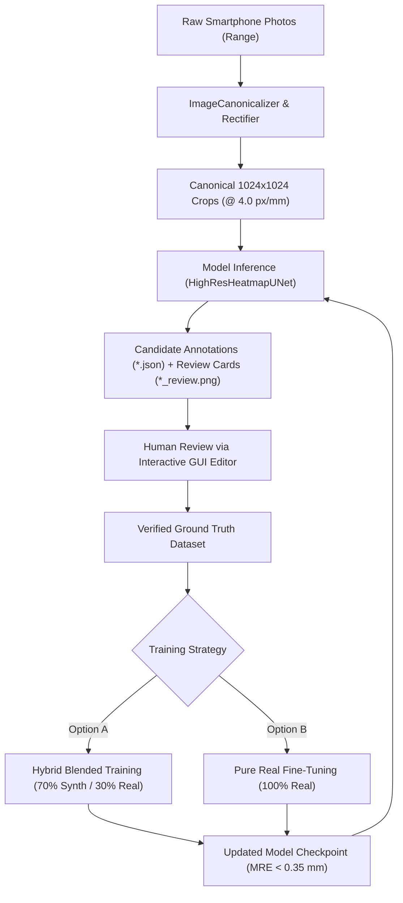

# End-to-End Training & Active Learning Workflow Tutorial

This tutorial walks through the complete operational lifecycle of the [`target_scorer`](file:///home/antho/target_scorer) system:
from taking raw smartphone photographs of competition targets on the range, to automated pre-rectification and assisted labeling, human-in-the-loop active learning, cloud and local hybrid training, and privacy-compliant production scoring.

---

## Table of Contents
1. [Operational Overview & Data Lifecycle](#1-operational-overview--data-lifecycle)
2. [Phase 1: Target Photography Best Practices](#2-phase-1-target-photography-best-practices)
3. [Phase 2: Automated Ingestion & Perspective Rectification](#3-phase-2-automated-ingestion--perspective-rectification)
4. [Phase 3: Model-Assisted Auto-Labeling](#4-phase-3-model-assisted-auto-labeling)
5. [Phase 4: Active Learning Verification & Human Review](#5-phase-4-active-learning-verification--human-review)
6. [Phase 5: Competitor Privacy & PII Redaction](#6-phase-5-competitor-privacy--pii-redaction)
7. [Phase 6: Hybrid Model Training Strategies](#7-phase-6-hybrid-model-training-strategies)
8. [Phase 7: Cloud GPU Acceleration via Google Colab CLI](#8-phase-7-cloud-gpu-acceleration-via-google-colab-cli)
9. [Phase 8: Production Deployment & Edge Integration](#9-phase-8-production-deployment--edge-integration)

---

## 1. Operational Overview & Data Lifecycle

The system operates on an active learning flywheel that continuously refines neural localization accuracy while minimizing human labeling effort:



---

## 2. Phase 1: Target Photography Best Practices

The system is camera-independent and tolerates perspective distortion up to $45^\circ$, variable lighting, and shadows. However, following these field guidelines maximizes detection confidence:

1. **Framing & Aspect Ratio:**
   * Frame the target card so the black aiming bullseye occupies between **15% and 60%** of the frame area.
   * Ensure all scoring rings of interest are within the photo frame.
2. **Lighting & Specular Glare:**
   * Avoid aiming harsh direct smartphone flashes at glossy cardboard targets. The built-in Navier-Stokes glare suppression can recover minor flash points, but diffuse ambient range lighting produces the cleanest results.
   * If shadows from range overhangs fall across the card, keep the angle consistent across shots.
3. **Orientation & Angle:**
   * Aim as close to perpendicular (normal) to the card as practical. The engine automatically recovers pitch/yaw tilts up to $\pm 45^\circ$, but oblique angles reduce resolution along the perspective-compressed axis.
4. **File Format Support:**
   * Shoot in native **Apple HEIC**, **Apple ProRAW DNG**, **Android Ultra HDR**, or **JPEG**. No manual conversion is required; the [`ImageCanonicalizer`](file:///home/antho/target_scorer/src/target_scorer/geometry/canonical_loader.py) handles format decoding, EXIF orientation tags (1–8), and Display P3 gamut mapping automatically.

---

## 3. Phase 2: Automated Ingestion & Perspective Rectification

Before neural inference, images undergo classical geometric unwarping to standardize orientation, scale, and perspective into a canonical square coordinate frame ($1024 \times 1024\text{ px}$ at exactly $4.0\text{ px/mm}$).

To test rectification on raw range photos before labeling:

```bash
target-scorer rectify \
  --image range_photos/target_01.heic \
  --target B-3 \
  --canvas-size 1024 \
  --scale 4.0 \
  --output datasets/calibration/target_01_canonical.png \
  --debug datasets/calibration/target_01_diag.png
```

### What Rectification Computes:
* **Laplacian Variance Motion Blur:** Quantifies sharpness. Values $> 75.0$ are accepted; lower values issue a blur warning.
* **Direct Least-Squares Ellipse Fit:** Fitzgibbon algebraic conic fitting on the outer bullseye boundary computes major/minor semi-axes $(a, b)$ and tilt angle $\theta = \arccos(b / a)$.
* **Homography Matrix:** A $3 \times 3$ projective transform warps the arbitrary ellipse into a metric circle with radius $r = 38.862\text{ mm}$ (for B-3) or $r = 38.989\text{ mm}$ (for B-2).

---

## 4. Phase 3: Model-Assisted Auto-Labeling

Rather than annotating bullet holes from scratch, use the trained competition model (`target_scoring_hrnet_1024_best.pt`) to automatically propose candidate coordinates, ring scores, and review cards.

### Batch Auto-Labeling Range Photos
Place your raw photos in a folder (e.g. `raw_range_snaps/`) and run:

```bash
target-scorer autolabel \
  --input-dir raw_range_snaps/ \
  --output-dir datasets/real_targets \
  --target B-3 \
  --checkpoint weights/target_scoring_hrnet_1024_best.pt \
  --canvas-size 1024 \
  --scale 4.0 \
  --threshold 0.40 \
  --shots 10 \
  --redact-pii
```

### Generated Triplet per Target Card:
For each photo `target_042.jpg`, the auto-labeler writes three files into `datasets/real_targets/`:
1. **`target_042_canonical.png`**: Rectified $1024 \times 1024$ image ($4.0\text{ px/mm}$) ready for PyTorch data loaders.
2. **`target_042.json`**: Ground-truth candidate annotation matching the [`TargetAnnotation`](file:///home/antho/target_scorer/src/target_scorer/data/schema.py) schema.
3. **`target_042_review.png`**: High-contrast visual card with green crosshairs, caliber circles, and HUD banner for rapid human inspection.

---

## 5. Phase 4: Active Learning Verification & Human Review

Human verification ensures that false positives (e.g. cardboard printing flecks or staple holes) are pruned and missed bullet tears (e.g. tightly clustered doubles) are stamped before feeding data into training.

### Step 1: Rapid Visual Screening
Browse through the generated `*_review.png` images in your image viewer. If a target shows 10 correct green rings and an accurate score HUD, it is verified.

### Step 2: Interactive Correction with the GUI Editor
For cards requiring adjustment, launch the editor:

```bash
target-scorer annotate datasets/real_targets
```

1. **Navigate to Card:** Press `N` / `P` to step through the dataset.
2. **Add Missed Holes:** If a shot was missed, click directly on the hole center. A new marker is stamped and scored.
3. **Reposition Markers:** Drag any marker to align perfectly with the hole's physical grease ring.
4. **Inspect Line Breaks:** Press `E` to open the **Eagle Eye Scoring Gauge** on contentious shots to verify NRA Rule 14.3 inward touches.
5. **Delete False Positives:** Right-click the erroneous marker or press `Delete`.
6. **Save Changes:** Press `Ctrl + S`. The `.json` file is updated with `manually_verified: true`, and the `*_review.png` is re-rendered.

---

## 6. Phase 5: Competitor Privacy & PII Redaction

Precision pistol target cards often include handwriting on the outer margins:
* Competitor Name & NRA Membership ID
* Relay Number, Firing Point, & Match Date
* Official Scorer Initials

When building public benchmark datasets or sharing review cards with competitors, use the `--redact-pii` flag:

```bash
target-scorer autolabel \
  --input-dir match_cards/ \
  --output-dir datasets/public_benchmark \
  --target B-3 \
  --redact-pii
```

### How Redaction Works:
The engine calculates the outer boundary of the official scoring area (e.g. radius of the 6-ring plus a safety margin). Any portion of the target outside this circular boundary is masked with an aggressive Gaussian blur ($45 \times 45$ kernel, $\sigma=25.0$) and watermarked with `[COMPETITOR REGISTRATION REDACTED]`. This completely obliterates handwriting while keeping all bullet tears and scoring rings 100% intact.

---

## 7. Phase 6: Hybrid Model Training Strategies

Once verified real targets are accumulated, train or fine-tune your model. The engine supports three training paradigms via [`HybridTargetDataset`](file:///home/antho/target_scorer/src/target_scorer/data/hybrid_dataset.py):

| Training Strategy | Real Ratio (`--real-ratio`) | Description | Best Used For |
| :--- | :---: | :--- | :--- |
| **Option A: Hybrid Blended** | `0.35` (35% Real, 65% Synth) | Interleaves procedural synthetic edge cases with real paper photographs. | **Recommended standard.** Prevents overfitting to a specific batch of paper while learning real grease rings and paper tear fibers. |
| **Option B: Pure Real Fine-Tuning**| `1.0` (100% Real) | Fine-tunes solely on real photographed targets. | Rapid domain adaptation to a specific club range's lighting, paper stock, or backer boards. |
| **Pure Procedural Synthetic** | `0.0` (0% Real) | Trains on 100% procedural synthetic cardboard textures and simulated tears. | Cold start when zero real annotated targets are available. |

### Running Local Hybrid Training
```bash
target-scorer train \
  --canvas-size 1024 \
  --scale 4.0 \
  --epochs 15 \
  --batch-size 2 \
  --lr 1.0e-4 \
  --sigma 3.2 \
  --real-data-dir datasets/real_targets \
  --real-ratio 0.35 \
  --initial-weights weights/target_scoring_hrnet_1024_best.pt \
  --checkpoint weights/target_scoring_hrnet_1024_hybrid.pt
```

---

## 8. Phase 7: Cloud GPU Acceleration via Google Colab CLI

For fast training of $1024 \times 1024$ models without heating up local hardware, use the automated Colab CLI orchestrator.

### Prerequisites:
Install and authenticate the Google Colab CLI:
```bash
colab auth
```

### 1-Click Cloud Hybrid Training on NVIDIA A100:
```bash
target-scorer colab-train \
  --canvas-size 1024 \
  --scale 4.0 \
  --epochs 15 \
  --batch-size 8 \
  --lr 1.0e-4 \
  --sigma 3.2 \
  --gpu A100 \
  --real-data-dir datasets/real_targets \
  --real-ratio 0.35 \
  --initial-weights weights/target_scoring_hrnet_1024_best.pt
```

### What Happens Automatically:
1. Queries your Colab compute unit balance (`colab usage`).
2. Bundles the codebase and compresses `datasets/real_targets/`.
3. Provisions a cloud VM with an **NVIDIA A100 40GB** GPU.
4. Uploads code, weights, and real data; installs dependencies in remote venv.
5. Runs mixed-precision training across 15 epochs in ~6 minutes.
6. Evaluates dual post-training scorecards (both NRA B-2 and B-3 demo cards).
7. Downloads the optimal `.pt` checkpoint and scorecards to your local `weights/` folder.
8. Releases the cloud session immediately to avoid wasting compute units.

---

## 9. Phase 8: Production Deployment & Edge Integration

Deploy the trained model into real-time match scoring systems or edge camera devices.

### Batch Evaluation CLI
```bash
target-scorer infer \
  --image match_scans/relay_3.png \
  --target B-3 \
  --checkpoint weights/target_scoring_hrnet_1024_hybrid.pt \
  --canvas-size 1024 \
  --output match_scans/relay_3_scorecard.png
```

### Embedded Python Camera Loop (e.g. Raspberry Pi Picamera2)
```python
import cv2
from target_scorer.geometry.rectifier import TargetRectifier
from target_scorer.infer import run_inference_and_scoring

rectifier = TargetRectifier(target_type="B-3", canonical_dim=1024, pixels_per_mm=4.0)

def score_live_target(frame_bgr):
    # Unwarp perspective
    rect_result = rectifier.rectify(frame_bgr)
    
    # Run neural inference
    shots, metrics = run_inference_and_scoring(
        checkpoint_path="weights/target_scoring_hrnet_1024_hybrid.pt",
        image_path=rect_result.canonical_crop,
        target_type="B-3",
        canvas_size=1024,
        pixels_per_mm=4.0,
        output_path="current_live_score.png"
    )
    
    return {
        "score": f"{metrics.total_score} - {metrics.x_count}X",
        "extreme_spread_mm": metrics.extreme_spread_mm,
        "mean_radius_mm": metrics.mean_radius_mm,
    }
```
