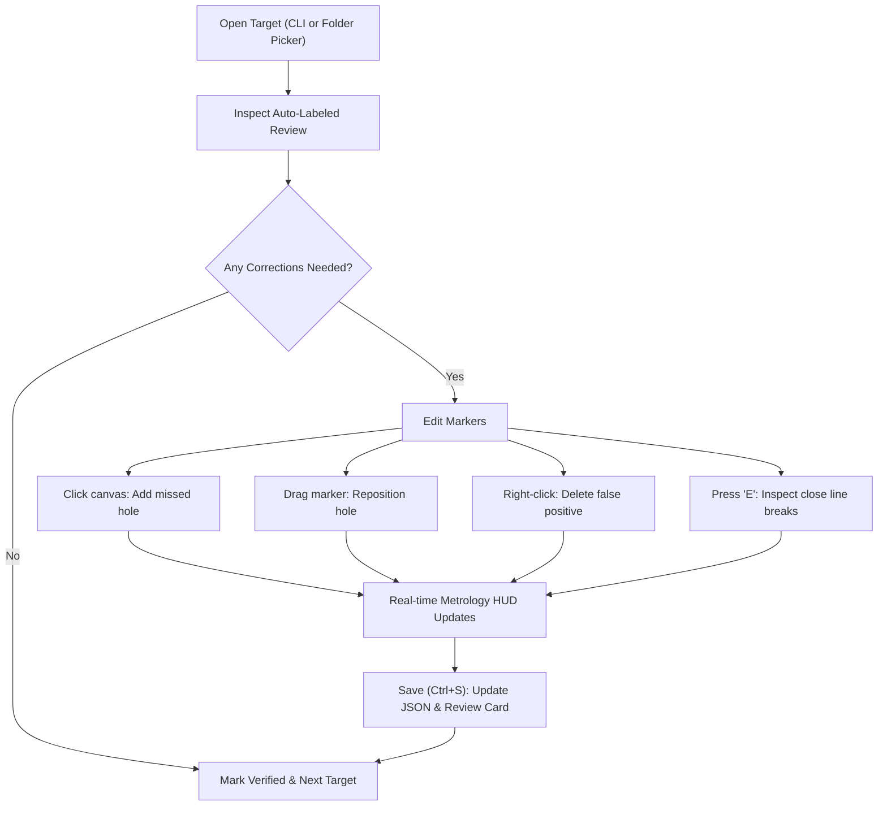

# Interactive Annotation & Metrology Editor Guide

The **Interactive Annotation & Metrology Editor** (`target-scorer annotate`) is a specialized desktop graphical user interface (GUI) engineered for competition review officers, range statisticians, and machine learning practitioners.

It bridges the gap between neural inference and official NRA precision pistol metrology by enabling rapid visual verification, point-and-click correction of bullet hole coordinates, real-time recalculation of inward break scores, and microscopic inspection via the **Eagle Eye Scoring Gauge**.

Source: [`src/target_scorer/gui/annotation_editor.py`](file:///home/antho/target_scorer/src/target_scorer/gui/annotation_editor.py)

---

## Table of Contents
1. [Launching the Editor](#1-launching-the-editor)
2. [Interface Layout & Toolbar](#2-interface-layout--toolbar)
3. [Canvas Navigation: Pan & Zoom](#3-canvas-navigation-pan--zoom)
4. [Overlays: Rings, Badges, & Dispersion](#4-overlays-rings-badges--dispersion)
5. [The Eagle Eye Scoring Gauge (Optical Loupe)](#5-the-eagle-eye-scoring-gauge-optical-loupe)
6. [Caliber Selection & Metrology Impact](#6-caliber-selection--metrology-impact)
7. [Editing Workflow (Add, Drag, Nudge, Delete, Save)](#7-editing-workflow-add-drag-nudge-delete-save)
8. [Complete Keyboard & Mouse Shortcuts Cheat Sheet](#8-complete-keyboard--mouse-shortcuts-cheat-sheet)

---

## 1. Launching the Editor

You can launch the editor against a directory of auto-labeled targets, a dataset directory, or an individual target JSON file:

```bash
# Launch on auto-labeled target directory
target-scorer annotate autolabeled_photos/B-3

# Launch on a specific dataset folder
target-scorer annotate datasets/real_targets

# Launch on a specific JSON file with forced NRA B-2 Slow Fire rules
target-scorer annotate datasets/real_targets/target_001.json --target B-2
```

If no path argument is provided, the editor automatically scans default locations (`autolabeled_photos/`, `datasets/real_targets/`) and loads the first valid annotation index found.

---

## 2. Interface Layout & Toolbar

```
┌────────────────────────────────────────────────────────────────────────────────────────────────────────┐
│ [📁 Open Dir] [◀ Prev] target_005.json [1/12] [Next ▶] | Mode: (•) Shots ( ) Bull | Caliber: [.22 LR] │ [💾 Save (Ctrl+S)] [↺ Revert] [✕ Clear]
├──────────────────────────────────────────────────────────────────────┬─────────────────────────────────┤
│ [Fit] [100%] [Zoom +] [Zoom -] 150% [✓] Rings [✓] Spread [✓] Badges  │ NRA TARGET SPECIFICATION        │
│                                                                      │ Target: NRA B-3 (50ft Rapid)    │
│                                                                      │ Scale: 4.00 px/mm | 1024x1024   │
│                                                                      ├─────────────────────────────────┤
│                                                                      │ SCORE: 98 - 4X / 100            │
│                     INTERACTIVE TARGET CANVAS                        │ Shots: 10 | X-Count: 4          │
│                                                                      │ Extreme Spread: 24.32 mm        │
│                - Smooth Pan & Zoom (20% - 1200%)                     │ Mean Radius:     8.14 mm        │
│                - Drag to reposition shot markers                     ├─────────────────────────────────┤
│                - Click to stamp new bullet impacts                   │ SHOT IMPACTS       [Re-number]  │
│                - Double-click shot to launch Eagle Eye               │ #  | Score | X? | Radius | Coords│
│                                                                      │ #1 |  10   | X  |  4.2mm | ...   │
│                                                                      │ #2 |  10   |    |  8.9mm | ...   │
│                                                                      ├─────────────────────────────────┤
│                                                                      │ [Delete Shot] [✕ Delete All]    │
│                                                                      │ [🔍 Eagle Eye (E)] [↺ Undo]     │
├──────────────────────────────────────────────────────────────────────┴─────────────────────────────────┤
│ Cursor: X=512.4, Y=498.2 (r=3.8 mm) | Ready. Click canvas to add shots | Press 'E' for Eagle Eye Loupe │
└────────────────────────────────────────────────────────────────────────────────────────────────────────┘
```

The application consists of four coordinated panels:
1. **Top Control Toolbar:** Dataset directory picker, sequential target navigation, mode toggles, caliber selection dropdown, and saving controls.
2. **Interactive Canvas (Center):** High-framerate rendering of the unwarped canonical target card with calibrated visual overlays.
3. **Metrology HUD & Shot Table (Right):** Live ballistic group statistics (Score, Extreme Spread, Mean Radius, COI) and interactive shot table. Selecting any row highlights the corresponding shot on canvas.
4. **Bottom Status Bar:** Live cursor coordinates (pixel space and millimeter radial distance from bullseye) and workflow state messages.

---

## 3. Canvas Navigation: Pan & Zoom

Inspecting bullet tears on 1024×1024 targets requires smooth navigation across varying magnification levels:

* **Cursor-Anchored Zoom:** Rotate the **Mouse Wheel** (or `+` / `-` keys). Zooming automatically anchors to the image coordinate directly beneath the cursor, preserving your point of interest.
* **Smooth Panning:** Click and drag with the **Middle Mouse Button** (Wheel Click) to pan freely across the target card.
* **Fit to Window (`F`):** Centers the target card and auto-scales the zoom factor so the entire target canvas is visible within the application window.
* **100% Zoom (`1`):** Resets the canvas to native $1:1$ pixel resolution ($1\text{ screen pixel} = 1\text{ canonical target pixel}$).

---

## 4. Overlays: Rings, Badges, & Dispersion

The canvas includes toggleable overlays configured via the canvas sub-toolbar:

### A. NRA Scoring Ring Guides (`[✓] NRA Ring Guides`)
Overlays calibrated concentric rings centered on the detected target bullseye:
* **X-Ring:** Highlighted in solid gold (`#ffd700`).
* **10-Ring through Outer Rings:** Clean dashed silver/slate guides (`#555866`) illustrating ring borders.

### B. Extreme Spread Connecting Line (`[✓] Extreme Spread Line`)
When two or more shots are present, the editor automatically computes the Euclidean distance between all possible shot pairs, identifies the two farthest impacts, and draws an orange dashed baseline connecting their centers. The exact physical measurement is displayed on the HUD in both millimeters and Minutes of Angle (MOA).

### C. Shot Badges (`[✓] Shot Badges`)
Each shot marker displays an identification pill badge adjacent to its caliber outline:
```
#<Shot ID>:<ScoreValue>[X]
```
For example, `#03:10X` denotes Shot #3 scored as an inner-X 10, while `#07:9` denotes Shot #7 scored as a 9.

---

## 5. The Eagle Eye Scoring Gauge (Optical Loupe)

In official precision pistol matches, contentious line breaks (where a bullet hole comes close to touching a higher-value scoring ring) are evaluated using a physical 4x–12x magnifier known as an **Eagle Eye scoring gauge** or scoring loupe.

The editor includes a built-in virtual **Eagle Eye Scoring Gauge** dialog simulating this physical instrument down to sub-pixel tolerances.

```
                  ┌──────────────────────────────────────────┐
                  │ SHOT #3 OPTICAL INSPECTION   [✕ Close]   │
                  ├──────────────────────────────────────────┤
                  │                                          │
                  │              (  8x Zoom  )               │
                  │             /             \              │
                  │            /     .-.       \             │
                  │           |    (  +  )      | <--- Flange│
                  │           \     `-'        /      Gauge  │
                  │            \              /              │
                  │             \____________/               │
                  │       - - - 10-Ring Arc - - - -          │
                  │                                          │
                  ├──────────────────────────────────────────┤
                  │ AWARDED: 10 [X]                          │
                  │ Touches 10-ring by +0.32 mm              │
                  │ (NRA Rule 14.3 Inward Break)             │
                  ├──────────────────────────────────────────┤
                  │ Loupe Zoom: [6x] [8x] [12x]              │
                  │ Nudge Step: [0.2px] [0.5px] [1.0px]      │
                  │                                          │
                  │                 [ ▲ ]                    │
                  │             [ ◀ ] ✛ [ ▶ ]                │
                  │                 [ ▼ ]                    │
                  │                                          │
                  │ [◀ Prev Shot (P)]      [Next Shot (N) ▶] │
                  │ [✕ Exit Eagle Eye (Esc / E)]             │
                  └──────────────────────────────────────────┘
```

### A. How the Loupe Works
1. **High-Power Magnification:** Crops a localized patch around the selected bullet impact and enlarges it with nearest-neighbor sub-pixel fidelity ($6\times$, $8\times$, or $12\times$).
2. **Scoring Ring Arcs:** Accurately renders the arcs of any NRA scoring rings passing through the magnifier's field of view, labeled with their ring denomination.
3. **Caliber Flange Reticle:** Overlays an engraved circular reticle matching the exact physical diameter of the selected caliber (.22 LR, 9mm, or .45 ACP).
4. **Sub-Pixel Crosshair:** A crimson crosshair identifies the exact continuous center coordinate $(x, y)$.

### B. NRA Rule 14.3 Inward Break Scoring
According to NRA Official Rule 14.3 (*Scoring of Shots*):
> *"A hole in the target, the leaded edge of which comes within a scoring ring, is given the higher value. If the outer edge of the flange on the scoring gauge touches or breaks the outside edge of any scoring ring line, the shot is awarded the higher value."*

The Eagle Eye dialog computes the physical distance from the bullet center to the bullseye, subtracts the bullet radius to find the outer flange tangent point:
$$d_{\text{gauge}} = \max\left(0, d_{\text{radial}} - \frac{\text{caliber}}{2}\right)$$
If $d_{\text{gauge}} \le r_{\text{ring}}$, the flange breaks the line, and the dialog awards the higher value with an explicit ruling annotation (e.g. `Touches 10-ring by +0.32 mm (NRA Rule 14.3 Inward Break)`).

### C. Launching & Exiting the Loupe
* **To Open:**
  * Press `E` on the keyboard with any shot selected.
  * Click the **🔍 Eagle Eye Gauge (E)** button on the sidebar.
  * **Double-click** any shot marker on the target canvas.
* **To Exit:**
  * Press `Escape` (Esc).
  * Press `E` or `Q`.
  * Click the top-right `✕ Close` button.
  * Click the full-width bottom `✕ Exit Eagle Eye` button.

### D. Fine Nudge Controls
While inspecting a shot under the loupe, fine adjustments can be made without touching the mouse:
* **Arrow Keys (`↑` / `↓` / `←` / `→`):** Nudges the bullet marker by the selected step size ($0.2\text{ px}$, $0.5\text{ px}$, or $1.0\text{ px}$).
* **Shift + Arrow Keys:** Rapid 3x step nudge.
* **Click-to-Center:** Clicking anywhere inside the loupe viewport instantly shifts the marker center to that exact pixel.
* **Cycle Shots:** Press `N` (Next) or `P` (Prev) to step through all shots sequentially without closing the loupe.

---

## 6. Caliber Selection & Metrology Impact

Bullet hole diameter directly influences whether a close shot breaks an inner scoring ring line. The top toolbar provides a calibrated caliber selector:

| Caliber Selection | Bullet Diameter ($\text{mm}$) | Bullet Radius ($\text{mm}$) | Standard Discipline |
| :--- | :---: | :---: | :--- |
| **`.22 LR (5.69 mm)`** | $5.69\text{ mm}$ ($0.224''$) | $2.845\text{ mm}$ | NRA Precision Pistol .22 Matches |
| **`9mm / .38 (9.02 mm)`** | $9.02\text{ mm}$ ($0.355''$) | $4.510\text{ mm}$ | Centerfire Pistol Matches |
| **`.45 ACP (11.48 mm)`** | $11.48\text{ mm}$ ($0.452''$) | $5.740\text{ mm}$ | .45 Caliber Precision Matches |

Selecting a new caliber immediately updates all caliber gauge outlines on the canvas and triggers a real-time recalculation of the entire scorecard.

---

## 7. Editing Workflow (Add, Drag, Nudge, Delete, Save)



### 1. Adding Missed Bullet Holes
If a shot was missed during automatic peak detection (e.g. tightly clustered doubles or keyholes):
1. Ensure Mode is set to **Shots**.
2. Click the left mouse button directly over the center of the bullet tear.
3. A new shot marker is stamped, assigned the next sequential ID, and immediately scored.

### 2. Moving / Dragging Shots
1. Click and hold the left mouse button on an existing shot marker.
2. Drag the marker to the correct geometric center.
3. Release the mouse button. The score and group metrics update dynamically.

### 3. Deleting False Positives
* **Single Shot:** Right-click directly on the shot marker, or select it in the table and press `Delete` or `Backspace`.
* **All Shots:** Click the `✕ Clear Shots` button to wipe all markers and re-annotate from scratch.

### 4. Adjusting the Target Bullseye Center
If paper deformation or printing irregularities displaced the bullseye:
1. Toggle Mode to **Bullseye Center** in the top toolbar.
2. Drag the gold bullseye crosshair to the exact center of the 10-ring.
3. All radial distances and ring scores recalculate instantly relative to the new origin.

### 5. Re-numbering Shots
If shots were added or deleted out of order, click **Re-number** in the shot table header to sequentially re-index shots from `1` to `N`.

### 6. Saving Annotations & Automatic Export to Dataset
Press `Ctrl+S` (or click **💾 Save JSON & Review**). This executes an atomic update:
1. Serializes the updated coordinates, caliber, ring scores, and dispersion metrics into the target's `.json` file.
2. Appends `manually_verified: true` and an ISO-8601 timestamp to the metadata.
3. Re-renders the visual verification card (`*_review.png`) on disk with updated crosshairs and HUD banner.

#### Optional Auto-Copy to Directory on Save:
When reviewing targets from a staging folder (such as `autolabeled_photos/B-2/JPEG/`), enable **"Copy on Save to directory:"** directly below the top toolbar (or pass `--copy-to-dir <PATH>` on launch):
* **Select Destination:** Click **📁 Browse Destination...** or type a path (e.g. `datasets/real_targets` or `datasets/real_targets/B-2`).
* **Automatic Assets Copied:**
  * **Annotation JSON:** Updated verified `.json` file.
  * **Canonical Image:** The rectified `*_canonical.png` ($1024 \times 1024$).
  * **Raw Photograph:** The original camera/scanner photo (e.g. `.jpg`), automatically located from metadata, sibling `raw/` folders, or `range_photos/`.
  * **Review Card:** The freshly rendered `*_review.png` verification card.
* **Smart Layout Routing:** If the destination contains `annotations/` and `canonical_1024/` subfolders, files are placed into their corresponding subdirectories; otherwise, they are copied into the selected directory.

---

## 8. Complete Keyboard & Mouse Shortcuts Cheat Sheet

### Main Window Shortcuts

| Shortcut | Context | Action |
| :--- | :--- | :--- |
| `Ctrl + S` | Global | Save annotations to JSON and regenerate `*_review.png` |
| `Ctrl + Z` | Global | Undo last modification (up to 30 steps) |
| `E` | Global | Toggle Eagle Eye Scoring Gauge dialog |
| `N` / `P` | Global | Navigate to Next / Previous target in directory |
| `F` | Global | Fit target canvas to window |
| `1` | Global | Reset zoom to 100% native resolution |
| `Del` / `Backspace` | Selected Shot | Delete the selected shot marker |
| `↑` / `↓` / `←` / `→` | Selected Shot | Nudge marker by $1\text{ px}$ |
| `Shift + Arrow Keys`| Selected Shot | Nudge marker by $5\text{ px}$ |
| `Left Click` (Empty Canvas) | Canvas | Add a new shot marker at cursor coordinate |
| `Left Click & Drag` | Shot Marker | Drag and reposition shot marker |
| `Double Click` | Shot Marker | Open Eagle Eye Loupe centered on shot |
| `Right Click` | Shot Marker | Delete shot marker immediately |
| `Middle Click & Drag` | Canvas | Pan canvas |
| `Mouse Wheel` | Canvas | Zoom in / Zoom out centered under cursor |

### Eagle Eye Loupe Dialog Shortcuts

| Shortcut | Context | Action |
| :--- | :--- | :--- |
| `Escape` / `Esc` | Loupe Dialog | Close loupe and return focus to main window |
| `E` / `Q` | Loupe Dialog | Close loupe dialog |
| `↑` / `↓` / `←` / `→` | Loupe Dialog | Nudge marker by active step size ($0.2\text{ px}$, $0.5\text{ px}$, or $1.0\text{ px}$) |
| `Shift + Arrow Keys`| Loupe Dialog | Nudge marker by $3\times$ active step size |
| `N` / `]` | Loupe Dialog | Advance loupe to Next shot |
| `P` / `[` | Loupe Dialog | Return loupe to Previous shot |
| `+` / `=` | Loupe Dialog | Increase loupe zoom magnification |
| `-` | Loupe Dialog | Decrease loupe zoom magnification |
| `Left Click` | Loupe Canvas | Recenter marker directly onto clicked sub-pixel |
