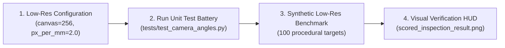

# Target Scoring Metrology Engine: Verification & Testing Plan

## 1. Resolution Recommendation & Analysis

To verify that the mathematical models, geometric rectification, sub-pixel coordinate regression, and official NRA scoring logic are 100% sound, testing should temporarily operate on a lightweight **low-resolution canonical canvas**.

### Resolution Comparison Matrix

| Parameter | Current Baseline | **Recommended Low-Res** | Overly Coarse |
| :--- | :--- | :--- | :--- |
| **Canvas Dimensions** | **$512 \times 512\text{ px}$** | **$256 \times 256\text{ px}$** | $128 \times 128\text{ px}$ |
| **Metric Scale ($S_{\text{canon}}$)** | $4.0\text{ px/mm}$ | **$2.0\text{ px/mm}$** | $1.0\text{ px/mm}$ |
| **Field of View (FOV)** | $128.0\text{ mm}$ ($5.04''$) | **$128.0\text{ mm}$ ($5.04''$)** | $128.0\text{ mm}$ ($5.04''$) |
| **Aiming Black Diameter (B-2)** | $311.9\text{ px}$ | **$155.95\text{ px}$** | $77.98\text{ px}$ |
| **.22 LR Bullet Diameter** | $22.76\text{ px}$ | **$11.38\text{ px}$** | $5.69\text{ px}$ |
| **Bullet Area** | $\approx 407\text{ px}^2$ | **$\approx 102\text{ px}^2$** | $\approx 25\text{ px}^2$ |
| **Heatmap Gaussian $\sigma$** | $2.5\text{ px}$ | **$1.5\text{ px}$** | $0.8\text{ px}$ (aliasing risk) |
| **U-Net Feature Stride** | $512 \to 256 \to 128 \to 64$ | **$256 \to 128 \to 64 \to 32$** | $128 \to 64 \to 32 \to 16$ |
| **Pixel Count / Memory** | $262,144\text{ px}$ ($1.0\times$) | **$65,536\text{ px}$ ($0.25\times$)** | $16,384\text{ px}$ ($0.06\times$) |
| **CPU Execution Time** | $\approx 120\text{ ms}$ | **$\approx 25\text{ ms}$ ($4.8\times$ faster)** | $\approx 8\text{ ms}$ |

### Why $256 \times 256$ at $2.0\text{ px/mm}$ is the Optimal Choice

1. **Exact Metric FOV Equivalence:** Both $512/4.0$ and $256/2.0$ provide an identical **$128.0\text{ mm}$ physical aperture**, capturing the full solid black bullseye ($77.98\text{ mm}$) and the 6-ring ($105.66\text{ mm}$) without changing camera framing.
2. **Clean Power-of-Two Divisibility:** The 3-stage pooling architecture in [`HighResHeatmapUNet`](file:///home/antho/target_scorer/target_inference_gauge_overlay_scoring_engine.py#L159) divides cleanly ($256 \to 128 \to 64 \to 32$), avoiding fractional padding or bilinear upsampling dimension mismatches.
3. **Adequate Nyquist Sampling for Bullet Holes:** A .22 LR bullet hole diameter spans **$11.38\text{ pixels}$** ($r \approx 5.7\text{ px}$). This provides over 100 pixels across the void, cleanly supporting:
   - A $5 \times 5$ morphological dilation kernel for Non-Maximum Suppression (NMS).
   - A $3 \times 3$ central-difference Hessian stencil for 2D Taylor-series sub-pixel estimation.
4. **Sub-Millimeter Mathematical Precision:** At $2.0\text{ px/mm}$, one whole pixel corresponds to $0.5\text{ mm}$. The Taylor series sub-pixel estimator refines positions to $< 0.1\text{ pixels}$, providing a theoretical localization accuracy of **$\approx 0.05\text{ mm}$**, well within competition scoring requirements.
5. **Ultra-Fast CPU Execution:** Unit tests and parameter sweeps run in $< 30\text{ ms}$ per sample, allowing complete test batteries to execute in seconds without requiring GPU acceleration.

---

## 2. Testing Architecture & Verification Workflow


---

## 3. Modular Verification Test Suite

### Module 1: Classical Geometric Rectifier (`test_rectifier_lowres.py`)

*Objective:* Verify that [`TargetRectifier`](file:///home/antho/target_scorer/target_rectifier.py) accurately locates the aiming black, derives an accurate 3x3 homography matrix, suppresses flash reflections, and warps the target into a canonical $256 \times 256$ frame with zero artificial roll rotation.

| Test ID | Condition | Inputs / Ground Truth | Verification Criteria |
| :--- | :--- | :--- | :--- |
| **GEO-01** | Flat Target (0° Tilt) | Orthogonal circle, $R_{\text{raw}} = 100.0\text{ px}$ | Rectified circularity $b/a \ge 0.985$, canonical radius within $\pm 0.8\text{ px}$ of $38.989 \times 2.0 = 77.98\text{ px}$. |
| **GEO-02** | Variable Pitch Tilt | Ellipses with pitch tilt $\theta \in \{15^\circ, 30^\circ, 42^\circ\}$ | Detected tilt angle error $|\hat{\theta} - \theta| < 2.5^\circ$. Unwarped target circularity $> 0.970$. |
| **GEO-03** | Roll Invariance | Ellipse oriented at arbitrary roll angles $\phi \in \{0^\circ, 35^\circ, 75^\circ, 90^\circ, 135^\circ\}$ | Orientation of canonical image matches input without unexpected 90° or random rotational flips. |
| **GEO-04** | Glare Inpainting | Specular hotspot ($V > 240, S < 30$) injected into black bull | Inpainted region restored; contour segmentation does not rupture; ellipse fitting succeeds. |
| **GEO-05** | Blur Metric Gate | Laplacian variance $\mathrm{Var}(\nabla^2 I) < 75.0$ | Result triggers `blur_metric` warning flag. |

---

### Module 2: Sub-Pixel Peak Extractor & Hessian Metrology (`test_peak_metrology.py`)

*Objective:* Verify that [`extract_subpixel_peaks`](file:///home/antho/target_scorer/infer_and_score.py#L32) accurately resolves continuous coordinates from continuous Gaussian heatmaps using the 2D Taylor series expansion $\Delta \mathbf{p} = -\mathbf{H}^{-1} \nabla f$.

| Test ID | Condition | Inputs / Ground Truth | Verification Criteria |
| :--- | :--- | :--- | :--- |
| **MET-01** | Sub-Pixel Center Accuracy | 2D Gaussian with center at sub-pixel offset $(128.35, 128.65)$, $\sigma = 1.5\text{ px}$ | Recovered peak error $\le 0.06\text{ px}$ ($\le 0.03\text{ mm}$ at $2.0\text{ px/mm}$). |
| **MET-02** | Hessian Definiteness | Stencil evaluated on saddle point ($\det < 0$) or flat plateau | Offset clamped to $(0.0, 0.0)$; no NaN/Inf or extrapolation divergence. |
| **MET-03** | Caliber-Aware NMS | Two adjacent shots separated by $8.0\text{ px}$ ($4.0\text{ mm}$, double shot) vs $4.0\text{ px}$ (same shot noise) | Double shot resolves as 2 distinct peaks; noise within suppression radius collapsed into 1 peak. |
| **MET-04** | Dynamic Range / Confidence | Peaks with confidence $0.90, 0.65, 0.40$ against threshold $0.45$ | Returns strictly the top 2 peaks in descending confidence order. |

---

### Module 3: Official NRA Inward Scoring & Ballistic Dispersion (`test_scoring_rules.py`)

*Objective:* Verify that [`score_target_group`](file:///home/antho/target_scorer/infer_and_score.py#L34) strictly follows official NRA Precision Pistol inward scoring rules and produces mathematically exact group statistics.

#### Ground Truth Test Cases for NRA Inward Scoring

```
NRA Inward Scoring Rule:
Effective Gauge Distance = max(0.0, Distance_to_Center - Bullet_Radius)
Bullet Radius = 5.69 mm / 2 = 2.845 mm
```

| Shot Vector | Ring Tested | Shot Center Dist ($d_{\text{shot}}$) | Ring Outer Radius ($R_{\text{ring}}$) | Effective Gauge Dist ($d_{\text{gauge}}$) | Expected Call |
| :---: | :---: | :---: | :---: | :---: | :---: |
| **SC-01** | B-2 Center X | $1.20\text{ mm}$ | $5.715\text{ mm}$ (X ring) | $0.00\text{ mm}$ | **X (10 pts)** |
| **SC-02** | B-2 Breaking 10 | $14.15\text{ mm}$ | $11.430\text{ mm}$ (10 ring) | $14.15 - 2.845 = 11.305\text{ mm} \le 11.430$ | **10 pts** (Line Breaker) |
| **SC-03** | B-2 Missing 10 | $14.35\text{ mm}$ | $11.430\text{ mm}$ (10 ring) | $14.35 - 2.845 = 11.505\text{ mm} > 11.430$ | **9 pts** (Touches 9 only) |
| **SC-04** | B-2 Breaking 8 | $31.00\text{ mm}$ | $28.321\text{ mm}$ (8 ring) | $31.00 - 2.845 = 28.155\text{ mm} \le 28.321$ | **8 pts** (Line Breaker) |
| **SC-05** | B-3 Breaking 9 | $41.50\text{ mm}$ | $38.862\text{ mm}$ (9 ring) | $41.50 - 2.845 = 38.655\text{ mm} \le 38.862$ | **9 pts** (Black edge touch) |

#### Dispersion Metrics Formulas Under Test

1. **Extreme Spread (ES):**
   $$\text{ES}_{\text{mm}} = \max_{i < j} \sqrt{(x_i - x_j)^2 + (y_i - y_j)^2}$$
2. **Center of Impact (COI):**
   $$\bar{x} = \frac{1}{N}\sum x_i, \quad \bar{y} = \frac{1}{N}\sum y_i$$
3. **Mean Radius (MR):**
   $$\text{MR}_{\text{mm}} = \frac{1}{N}\sum_{i=1}^N \sqrt{(x_i - \bar{x})^2 + (y_i - \bar{y})^2}$$
4. **Minutes of Angle (MOA):**
   $$\text{MOA} = \frac{\text{Spread}_{\text{mm}}}{16.67\text{ yd} \times 0.26598} \approx \frac{\text{Spread}_{\text{mm}}}{4.4339}$$

---

## 4. Step-by-Step Implementation & Execution Roadmap



### Phase 1: Parameterize Resolution in Core Engine
Ensure all scripts accept `canvas_size=256` and `pixels_per_mm=2.0` dynamically via configuration without hardcoded values:
- [`TargetRectifier`](file:///home/antho/target_scorer/target_rectifier.py): `canonical_dim=256`, `pixels_per_mm=2.0`
- [`TargetRingsConfig`](file:///home/antho/target_scorer/infer_and_score.py#L29): Scaled ring pixel tables
- [`HighResHeatmapUNet`](file:///home/antho/target_scorer/infer_and_score.py#L31): Verified with `(1, 3, 256, 256)` tensor input

### Phase 2: Execute Unit & Mathematical Assertions
Run the comprehensive test battery covering:
1. Pure geometric rectification on synthetic tilted ellipses.
2. Taylor-series sub-pixel convergence.
3. Edge-case line-breaking NRA scoring evaluations.
4. Dispersion and MOA calculation precision.

### Phase 3: Benchmark Low-Res Statistical Performance
Generate 100 procedural targets at $256 \times 256$ with randomized shot counts, doubles, keyholes, and residual tilt:
- **Accuracy Target:** Mean Radial Error (MRE) $< 0.12\text{ mm}$ ($< 0.24\text{ px}$).
- **Throughput Target:** $> 35\text{ targets/sec}$ on CPU.
- **Scoring Consistency:** 100% agreement between geometric ground truth gauge intersection and evaluated ring value.

### Phase 4: Full-Scale Validation Transition
Once all tests pass cleanly at $256 \times 256$:
- Scale canvas to $512 \times 512$ ($4.0\text{ px/mm}$) for production training/inference.
- Confirm identical score assignments between low-res and production resolutions on standard test sets.
