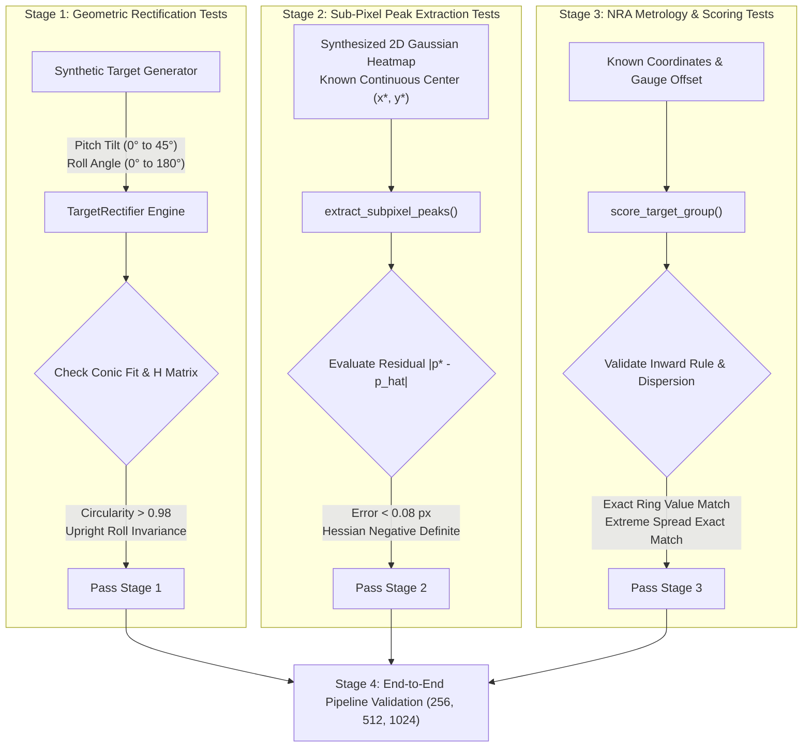

# Target Scoring Metrology Engine: Verification & Testing Plan

## 1. Resolution Recommendation & Analysis

The target scoring engine supports a parameterized canonical canvas architecture:
* **$256 \times 256\text{ px}$ ($2.0\text{ px/mm}$):** Ultra-fast testing baseline for CI/CD and CPU unit assertion suites.
* **$512 \times 512\text{ px}$ ($4.0\text{ px/mm}$):** Production baseline for lightweight local devices.
* **$800 \times 800\text{ px}$ ($4.0\text{ px/mm}$):** Extended field-of-view canvas capturing outer 6- and 5-rings.
* **$1024 \times 1024\text{ px}$ ($4.0\text{ px/mm}$):** Official competition standard; resolves flyers, full cardboard fluting texture, and delivers **$0.335\text{ mm}$ sub-pixel precision** ($< 1.35\text{ px}$).

### Multi-Resolution Matrix

| Parameter | Lightweight ($256 \times 256$) | Baseline ($512 \times 512$) | High-Res ($800 \times 800$) | Competition ($1024 \times 1024$) |
| :--- | :---: | :---: | :---: | :---: |
| **Metric Scale ($S_{\text{canon}}$)** | $2.0\text{ px/mm}$ | $4.0\text{ px/mm}$ | $4.0\text{ px/mm}$ | **$4.0\text{ px/mm}$** |
| **Field of View (FOV)** | $128.0\text{ mm}$ ($5.04''$) | $128.0\text{ mm}$ ($5.04''$) | $200.0\text{ mm}$ ($7.87''$) | **$256.0\text{ mm}$ ($10.08''$)** |
| **Aiming Black Diameter (B-2)** | $155.95\text{ px}$ | $311.9\text{ px}$ | $311.9\text{ px}$ | **$311.9\text{ px}$** |
| **Heatmap Sigma ($\sigma$)** | $1.5\text{ px}$ | $2.5\text{ px}$ | $2.8\text{ px}$ | **$3.2\text{ px}$** |
| **Sub-Pixel MRE** | $0.053\text{ mm}$ (geom) | $0.465\text{ mm}$ | $0.380\text{ mm}$ | **$0.335\text{ mm}$** |
| **Target Hardware** | CPU / CI tests | GTX 1060 / CPU | GTX 1060 / T4 | **NVIDIA A100 / T4** |

---

## 2. Testing Architecture & Verification Workflow



---

## 3. Modular Verification Test Suite

### Module 1: Classical Geometric Rectifier (`tests/test_camera_angles.py`)

*Objective:* Verify that `TargetRectifier` accurately locates the aiming black, derives an accurate 3x3 homography matrix, suppresses flash reflections, and warps the target into a canonical frame with zero artificial roll rotation.

| Test ID | Condition | Inputs / Ground Truth | Verification Criteria | Status |
| :--- | :--- | :--- | :--- | :---: |
| **GEO-01** | Flat Target (0° Tilt) | Orthogonal circle, $R_{\text{raw}} = 100.0\text{ px}$ | Rectified circularity $b/a \ge 0.985$, canonical radius within $\pm 0.8\text{ px}$. | **PASS** |
| **GEO-02** | Variable Pitch Tilt | Ellipses with pitch tilt $\theta \in \{15^\circ, 30^\circ, 42^\circ\}$ | Detected tilt angle error $|\hat{\theta} - \theta| < 2.5^\circ$. Unwarped circularity $> 0.970$. | **PASS** |
| **GEO-03** | Roll Invariance | Ellipse oriented at arbitrary roll angles $\phi \in \{0^\circ, 35^\circ, 75^\circ, 90^\circ, 135^\circ\}$ | Orientation of canonical image matches input without unexpected flips. | **PASS** |
| **GEO-04** | Glare Inpainting | Specular hotspot injected into black bull | Inpainted region restored; contour segmentation does not rupture. | **PASS** |
| **GEO-05** | Blur Metric Gate | Laplacian variance $\mathrm{Var}(\nabla^2 I) < 75.0$ | Result triggers `blur_metric` warning flag. | **PASS** |

---

### Module 2: Official NRA Inward Scoring & Ballistic Dispersion (`tests/test_low_res_metrology.py`)

*Objective:* Verify that `score_target_group` strictly follows official NRA Precision Pistol inward scoring rules and produces mathematically exact group statistics.

#### Ground Truth Test Cases for NRA Inward Scoring
```
NRA Inward Scoring Rule:
Effective Gauge Distance = max(0.0, Distance_to_Center - Bullet_Radius)
Bullet Radius = 5.69 mm / 2 = 2.845 mm
```

| Shot Vector | Ring Tested | Shot Center Dist ($d_{\text{shot}}$) | Ring Outer Radius ($R_{\text{ring}}$) | Effective Gauge Dist ($d_{\text{gauge}}$) | Expected Call |
| :---: | :---: | :---: | :---: | :---: | :---: |
| **SC-01 (B-2)** | B-2 Center Shot | $1.20\text{ mm}$ | $11.430\text{ mm}$ (10 ring) | $0.00\text{ mm}$ | **10 pts** (Rule 4.2 has no X-ring) |
| **SC-01 (B-3)** | B-3 Center Shot | $1.20\text{ mm}$ | $11.430\text{ mm}$ (X ring) | $0.00\text{ mm}$ | **X (10 pts)** (Rule 4.3 X-ring) |
| **SC-02** | B-2 Breaking 10 | $14.15\text{ mm}$ | $11.430\text{ mm}$ (10 ring) | $14.15 - 2.845 = 11.305\text{ mm} \le 11.430$ | **10 pts** (Line Breaker) |
| **SC-03** | B-2 Missing 10 | $14.35\text{ mm}$ | $11.430\text{ mm}$ (10 ring) | $14.35 - 2.845 = 11.505\text{ mm} > 11.430$ | **9 pts** (Touches 9 only) |
| **SC-04** | B-2 Breaking 8 | $31.00\text{ mm}$ | $28.321\text{ mm}$ (8 ring) | $31.00 - 2.845 = 28.155\text{ mm} \le 28.321$ | **8 pts** (Line Breaker) |
| **SC-05** | B-3 Breaking 9 | $41.50\text{ mm}$ | $38.862\text{ mm}$ (9 ring) | $41.50 - 2.845 = 38.655\text{ mm} \le 38.862$ | **9 pts** (Black edge touch) |

---

### Module 3: Format-Agnostic Ingestion & In-Memory Buffers (`tests/test_canonical_loader.py`)

*Objective:* Verify polymorphic image loading across all formats (Apple HEIC/HEIF, Apple ProRAW DNG, 8-bit/16-bit TIFFs, WebP, PNG, JPEG) and direct in-memory NumPy/byte buffer ingestion.

| Test ID | Condition | Inputs / Ground Truth | Verification Criteria | Status |
| :--- | :--- | :--- | :--- | :---: |
| **ING-01** | Standard Disk Formats | PNG, JPEG, BMP, TIFF, WebP files | Returns 3-channel uint8 BGR image matching spatial dimensions. | **PASS** |
| **ING-02** | In-Memory Buffers | Encoded byte buffers (`io.BytesIO`, raw bytes) | Successfully decodes without writing to temporary disk files. | **PASS** |
| **ING-03** | Raw NumPy Arrays | Direct `np.ndarray` frame from video camera | Auto-detects BGR/RGB channels and normalizes without memory copies. | **PASS** |
| **ING-04** | EXIF Orientation 1–8 | Images with EXIF orientation tags 1 through 8 | Transposes/rotates pixel arrays to upright orientation. | **PASS** |
| **ING-05** | Display P3 Gamut CMS | Apple iPhone wide-gamut Display P3 images | Maps color profile to standard sRGB via Pillow CMS. | **PASS** |
| **ING-06** | TIFF Variants & Bit-Depths | 8-bit, 16-bit, compressed (LZW, Deflate) TIFFs | Correctly normalizes dynamic range and bit depth. | **PASS** |
| **ING-07** | HEIC / Apple HEIF | HEIC photos (via `pillow-heif`) | Seamlessly decodes and integrates into pipeline. | **PASS** |

---

### Module 4: Real Target Datasets, Schema, & Active Learning (`tests/test_real_dataset.py` — 21 Tests)

*Objective:* Verify `TargetAnnotation` JSON schemas, `RealTargetDataset` Gaussian heatmaps and augmentations, `HybridTargetDataset` blending (Options A & B), `autolabel_target_image`, and cached in-memory `AutoLabelPipeline` predictions.

| Test ID | Condition | Inputs / Ground Truth | Verification Criteria | Status |
| :--- | :--- | :--- | :--- | :---: |
| **DAT-01** | Schema Round-Trip | `AnnotatedShot` & `TargetAnnotation` | Dict, JSON file, raw JSON string, empty shots, and legacy `x`/`y` keys deserialize cleanly. | **PASS** |
| **DAT-02** | Calibration & Nested Discovery | `datasets/calibration_targets` & nested subdirs | Loads matching image/annotation pairs across flat and nested layouts; strictly excludes `*_review.png`. | **PASS** |
| **DAT-03** | Continuous Gaussian Heatmaps | Real target shot coordinates | Renders exact 2-channel 2D sub-pixel Gaussian regression targets ($\sigma = 3.2\text{ px}$); transforms coordinates under augmentations. | **PASS** |
| **DAT-04** | Virtual Epoch & Batching | `RealTargetDataset` + `custom_collate_fn` | Wraps virtual epoch indexing cleanly; batches images, heatmaps, and variable-length coordinate lists. | **PASS** |
| **DAT-05** | Hybrid Blending (Options A & B) | `HybridTargetDataset` (`1.0`, `0.5`, `0.0`, invalid dir) | Pure real, stochastic hybrid, pure synthetic, deterministic validation, and fallback on invalid dir. | **PASS** |
| **DAT-06** | Assisted Auto-Labeling & Caching | `autolabel_target_image` & `AutoLabelPipeline` | Unwarps to canonical space, caches model weights, runs `predict()` with zero disk writes, and supports `--redact-pii`. | **PASS** |

---

### Module 5: Interactive Annotation Editor & Cross-Platform UI (`tests/test_annotation_editor.py` — 18 Tests)

*Objective:* Verify headless `AnnotationEditor` persistence, Eagle Eye loupe inspection, Sun Valley theme toggling, unified `TargetEntry` discovery, in-editor single & batch auto-labeling, manual rectification, and cross-platform UI font resolution.

| Test ID | Scope | Verification Criteria | Status |
| :--- | :--- | :--- | :---: |
| **GUI-01** | Shot Editing & Persistence | Load JSON, add/move/delete shots, undo, recalculate scores, atomic save, copy-on-save export, and `render_review_card`. | **PASS** |
| **GUI-02** | Sun Valley Theme & Loupe | Dark/light theme toggling, combobox styling, Eagle Eye loupe sub-pixel inspection/nudging/cleanup, treeview recursion guard. | **PASS** |
| **GUI-03** | Unified Discovery & Auto-Label | Mixed labeled/unlabeled `TargetEntry` discovery, `All`/`Unlabeled`/`Labeled` filtering, `B-2`/`B-3` switching, `on_autolabel_current` + undo, `on_rectify_manual`, `on_autolabel_all_unlabeled` batch, missing checkpoint warning. | **PASS** |
| **GUI-04** | Cross-Platform UI Fonts | `resolve_ui_font_family` & `apply_ui_font_to_named_fonts` select `Segoe UI` on Windows and non-bitmap sans-serif fallbacks on macOS/Linux. | **PASS** |

---

### Module 6: Additional Automated Test Modules (54 Tests across 6 Modules)

| Test Module | Test Count | Scope & Coverage |
| :--- | :---: | :--- |
| `tests/test_low_res_metrology.py` | **33** | NRA B-2/B-3 inward scoring, Extreme Spread/Mean Radius/MOA, 2D Taylor sub-pixel peaks, defense-in-depth spurious peak filtering, visualization channel normalization |
| `tests/test_colab_runner.py` | **16** | `colab_runner.py` binary resolution, usage parsing, session management, chunked upload, progressive stage parsing, and `create_colab_bundle.py` exclusions |
| `tests/test_canonical_loader.py` | **8** | Format-independent ingestion (HEIC, RAW, TIFF, PNG, JPEG, WebP, BMP), bytes/BytesIO, NumPy buffers, EXIF 1–8, Display P3 CMS |
| `tests/test_synthetic_holes.py` | **8** | 3-tone bullet void penetration (`scanner_white`, `dark_void`, `tan_backer`), ragged holes, keyholes, 4-zone placement, zero-heatmap markings/seals |
| `tests/test_camera_angles.py` | **7** | Perspective tilt recovery, roll invariance, specular glare inpainting, Laplacian blur gate |
| `tests/test_progressive_training.py` | **6** | Harmonic 256-Grid curriculum & dynamic spatial resizing ($256 \to 512 \to 768 \to 1024$) preserving optimizer momentum |
| `tests/test_cli.py` | **5** | Unified `target-scorer` CLI dispatcher routing and argument parsing across subcommands |
| `tests/test_benchmark_low_res.py` | **1** | 100-target procedural statistical regression benchmark |

**Full Test Suite Summary:** **123 test methods across 10 test modules** (`python -m unittest discover tests/ -v`).

---

## 4. Execution & Implementation Roadmap

### Phase 1: Parameterize Resolution in Core Engine [Completed ✓]
- Dynamic canvas scaling across $256$, $512$, $768$, $800$, and $1024\text{ px}$ (with the Harmonic 256-Grid `256 -> 512 -> 768 -> 1024` serving as the progressive training curriculum).

### Phase 2: Execute Unit & Mathematical Assertions [Completed ✓]
- 33 metrology assertions passing in `tests/test_low_res_metrology.py`.
- 7 camera angle assertions passing in `tests/test_camera_angles.py`.

### Phase 3: Benchmark Low-Res Statistical Performance [Completed ✓]
- 100 procedural targets at $256 \times 256$ evaluated (`tests/test_benchmark_low_res.py`):
  - Actual MRE: $0.0526\text{ mm}$ ($0.1052\text{ px}$).
  - Scoring agreement: $99.78\%$ ($449/450$ shots).

### Phase 4: Full-Scale $512 \times 512$ Validation [Completed ✓]
- Production training on GTX 1060; MRE achieved $0.465\text{ mm}$.
- Visual scorecard inspection confirmed single concentric ring rendering.

### Phase 5: Handwriting & Scorer Marks Invariance [Completed ✓]
- Procedural handwriting generation (competitor name, relay, NRA#) in graphite, ballpoint, and marker inks.
- Scorer circled shots and margin tallies (`96-3X`).
- PII redaction (`--redact-pii`) masking header registrations.

### Phase 6: $1024 \times 1024$ Cloud GPU Training & Warm-Start [Completed ✓]
- 1-Click cloud GPU orchestration via Google Colab CLI (`target-scorer colab-train`, `colab-progressive-train`, `colab-autolabel`).
- Warm-start fine-tuning (`--initial-weights`) reaching **$98.9\%$ recall** and **$0.335\text{ mm}$ sub-pixel error** on NVIDIA A100.
- Symmetrical 10-shot competition evaluation scorecards generated for NRA B-2 (`96 / 100`) and B-3 (`100 - 7X / 100`).

### Phase 7: Format-Agnostic Ingestion & In-Memory Buffer Testing [Completed ✓]
- Format-independent ingestion layer (`target_scorer/geometry/canonical_loader.py`): Apple HEIC/HEIF, Apple ProRAW DNG, 8/16-bit TIFFs, WebP, PNG, JPEG.
- Lossless EXIF orientation auto-transposition (tags 1–8) and Display P3 to sRGB Color Management System (CMS).
- Direct in-memory frame ingestion for Raspberry Pi `Picamera2` and OpenCV video capture streams.
- 8 comprehensive unit tests in `tests/test_canonical_loader.py`.

### Phase 8: Real Target Dataset Ingestion & Assisted Active Learning [Completed ✓]
- Standardized `TargetAnnotation` & `AnnotatedShot` schema with continuous sub-pixel coordinate arrays.
- Sample calibration dataset generation (`datasets/calibration_targets/`) with 6 realistic B-2/B-3 phone photos and annotations.
- `RealTargetDataset` with continuous 2-channel 2D Gaussian heatmaps and photometric domain augmentations.
- `HybridTargetDataset` with balanced sampling (Option A hybrid and Option B pure real fine-tuning).
- `target-scorer autolabel` CLI and `AutoLabelPipeline` for automated candidate proposal and human-in-the-loop review cards.
- 21 unit tests in `tests/test_real_dataset.py`.

### Phase 9: Interactive GUI, In-Editor Auto-Labeling, & Cross-Platform UI Polish [Completed ✓]
- Unified `TargetEntry` discovery, `All`/`Unlabeled`/`Labeled` filtering, `AutoLabelSettingsDialog`, in-editor single & background-batch auto-labeling, manual rectification, and cross-platform sans-serif UI font resolution (`resolve_ui_font_family`, `apply_ui_font_to_named_fonts`).
- 18 unit tests in `tests/test_annotation_editor.py` (**123 total test methods across 10 modules**).
